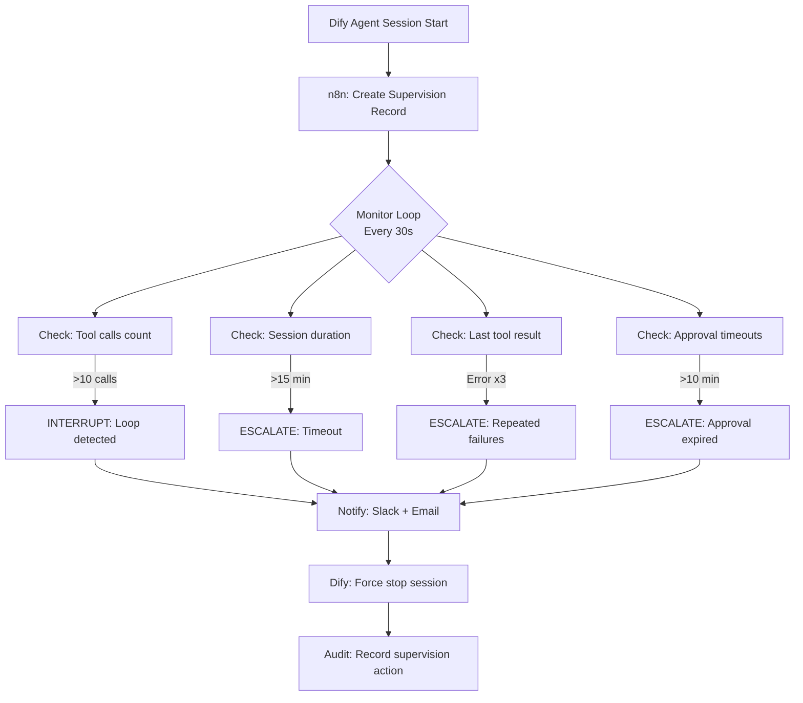

# Módulo 6: Orquestación de agentes con Dify y n8n

> **Duración:** 3 horas | **Formato:** Teoría (45 min) + Demo (20 min) + Labs (90 min) + Repaso (25 min)

---

## Objetivos del módulo

Al finalizar, los participantes podrán:

- Diseñar **patrones de integración** n8n ↔ Dify (event-driven, human-in-loop, structured output)
- Construir **agentes con herramientas limitadas y verificables** en Dify
- Implementar **validación previa, aprobación humana y registro de acciones** agénticas
- Aplicar **criterios de interrupción, reorientación y escalado** de tareas agénticas
- Orquestar **workflows híbridos** determinista + IA con trazabilidad completa

---

## 6.1 Patrones de integración

### n8n recibe un evento, Dify analiza el caso y n8n ejecuta la acción

> **Patrón 1: "Analyze & Act" (Event-Driven)**

```
┌─────────────────────────────────────────────────────────────────────────────┐
│                        PATRÓN: n8n → Dify → n8n                             │
│                                                                             │
│  EXTERNAL EVENT                                                             │
│       │                                                                     │
│       ▼                                                                     │
│  ┌─────────┐     ┌─────────────────┐     ┌─────────────────────────────┐  │
│  │  n8n    │────▶│      Dify       │────▶│           n8n               │  │
│  │ Webhook │     │  Workflow/Agent │     │  Execution Workflow         │  │
│  │ Trigger │     │  (Analysis)     │     │  (Deterministic Actions)    │  │
│  └─────────┘     └─────────────────┘     └─────────────────────────────┘  │
│       │                  │                          │                      │
│       │                  │                          │                      │
│       ▼                  ▼                          ▼                      │
│  Recibe:            Analiza:                  Ejecuta:                   │
│  - Alert JSON     - Clasifica               - Crea ticket Jira           │
│  - Git push       - Enriquece (RAG)         - Reinicia pod (kubectl)     │
│  - Ticket creado  - Recomienda acción       - Escala en PagerDuty        │
│  - Scheduled      - Devuelve JSON           - Notifica Slack             │
│                   estructurado              - Registra audit log         │
└─────────────────────────────────────────────────────────────────────────────┘
```

**Flujo de datos:**

| Paso | Componente | Input | Output | Contrato |
|------|------------|-------|--------|----------|
| 1 | n8n Webhook | HTTP POST (alert) | `alert_json` | Validado schema |
| 2 | n8n HTTP Request → Dify | `alert_json` + `context` | `analysis_json` | **Dify Workflow API** |
| 3 | n8n IF/Switch | `analysis_json` | Rama según `action_required` | `action_required: true/false` |
| 4 | n8n Actions | `analysis_json` | `execution_results` | Determinístico, auditable |
| 5 | n8n Merge + Respond | `analysis_json` + `execution_results` | `final_response` | Correlation ID |

**Contrato Dify → n8n (Output Schema obligatorio):**

```json
{
  "analysis_id": "ana-{{ $now.format('yyyyMMddHHmmssSSS') }}",
  "classification": {
    "category": "infrastructure|application|security|data",
    "priority": "P1|P2|P3|P4",
    "confidence": 0.95
  },
  "enrichment": {
    "affected_service": "payment-api",
    "owner_team": "platform",
    "runbook_url": "https://wiki/runbooks/pod-oom",
    "recent_deployments": ["v2.3.1 (2h ago)"]
  },
  "recommendation": {
    "action_required": true,
    "action_type": "restart_pod|scale_deployment|create_ticket|escalate|investigate",
    "action_params": {
      "namespace": "production",
      "deployment": "payment-api",
      "reason": "OOMKilled - memory limit exceeded"
    },
    "requires_approval": true,
    "approval_reason": "Reinicio de pod en producción"
  },
  "reasoning": "Pod OOMKilled en prod. Deploy reciente v2.3.1 aumentó memoria. Runbook recomienda reinicio tras validar limits.",
  "sources": ["alert", "cmdb", "runbook", "deployment_history"]
}
```

> 💡 **Clave:** Dify **solo analiza y recomienda**. n8n **ejecuta**. Separación de responsabilidades = seguridad + auditoría.

---

### Dify conversa con el usuario y delega operaciones controladas en un workflow

> **Patrón 2: "Chat → Delegate" (Conversational Automation)**

```
┌─────────────────────────────────────────────────────────────────────────────┐
│                        PATRÓN: Dify Chat → n8n Webhook                      │
│                                                                             │
│  USER (Slack/Teams/Web)                                                     │
│       │                                                                     │
│       ▼                                                                     │
│  ┌─────────────────┐     ┌─────────────────┐     ┌─────────────────────┐  │
│  │   Dify Chat     │────▶│    n8n Webhook  │────▶│   n8n Workflow      │  │
│  │   App / Agent   │     │   (Secure)      │     │   (Execution)       │  │
│  └─────────────────┘     └─────────────────┘     └─────────────────────┘  │
│       │                        │                        │                  │
│       │ 1. Usuario pide:      │ 2. Valida:              │ 3. Ejecuta:      │
│       │ "Reinicia payment-api"│ - Auth token            │ - kubectl rollout│
│       │                       │ - Params schema         │   restart        │
│       │                       │ - Approval check        │ - Wait ready     │
│       │                       │ - Rate limit            │ - Verify health  │
│       │                       │                         │                  │
│       ▼                        ▼                        ▼                  │
│  4. Responde:             5. Callback:              6. Audit:           │
│  "Ejecutando...           n8n → Dify Webhook        Log completo        │
│   Te aviso al terminar"     (async result)          + Notificación      │
└─────────────────────────────────────────────────────────────────────────────┘
```

**Implementación en Dify Agent (Function Calling):**

```yaml
# Tool definition en Dify Agent
tools:
  - name: "execute_restart_deployment"
    description: "Reinicia un deployment en Kubernetes (requiere aprobación)"
    parameters:
      type: object
      properties:
        namespace:
          type: string
          description: "Namespace del deployment (ej. production)"
        deployment:
          type: string
          description: "Nombre del deployment"
        reason:
          type: string
          description: "Justificación técnica"
        approval_token:
          type: string
          description: "Token de aprobación previa (obtenido via get_approval)"
      required: [namespace, deployment, reason, approval_token]
    # Dify llama a n8n webhook interno
    # n8n valida approval_token, ejecuta, devuelve resultado
```

**Flujo de aprobación (Human-in-the-loop):**

```
Dify Agent quiere ejecutar restart_pod
       │
       ▼
Tool: get_approval (n8n webhook)
       │
       ▼
n8n: Crea registro aprobación pendiente
     → Notifica Slack @oncall con botones: ✅ Aprobar / ❌ Rechazar
     → Guarda approval_token (JWT firmado, TTL 10min)
       │
       ▼
Usuario click ✅ Aprobar
       │
       ▼
n8n: Valida token → Marca aprobado → Devuelve approval_token a Dify
       │
       ▼
Dify Agent: Ejecuta execute_restart_deployment con approval_token
       │
       ▼
n8n: Valida token → Ejecuta kubectl → Devuelve resultado
```

---

### Uso de salidas estructuradas para conectar IA con automatizaciones deterministas

> **Principio:** **JSON Schema como contrato** entre Dify y n8n.

#### Definición de contrato (OpenAPI / JSON Schema compartido)

```yaml
# contracts/analysis-output.yaml
openapi: 3.0.0
info:
  title: "Dify Analysis Output Contract"
  version: "1.2.0"
components:
  schemas:
    AnalysisOutput:
      type: object
      required: [analysis_id, classification, recommendation, reasoning, sources]
      properties:
        analysis_id:
          type: string
          pattern: "^ana-\d{17}$"
        classification:
          $ref: '#/components/schemas/Classification'
        enrichment:
          $ref: '#/components/schemas/Enrichment'
        recommendation:
          $ref: '#/components/schemas/Recommendation'
        reasoning:
          type: string
          maxLength: 500
        sources:
          type: array
          items:
            type: string
            enum: [alert, cmdb, runbook, deployment_history, knowledge_base, inference]
    Classification:
      type: object
      required: [category, priority, confidence]
      properties:
        category:
          type: string
          enum: [infrastructure, application, security, data, network]
        priority:
          type: string
          enum: [P1, P2, P3, P4]
        confidence:
          type: number
          minimum: 0
          maximum: 1
    Recommendation:
      type: object
      required: [action_required, action_type, requires_approval]
      properties:
        action_required:
          type: boolean
        action_type:
          type: string
          enum: [restart_pod, scale_deployment, create_ticket, escalate, investigate, no_action]
        action_params:
          type: object
        requires_approval:
          type: boolean
        approval_reason:
          type: string
```

> 💡 **En n8n:** Usar **Function node** al recibir de Dify para **validar schema** (AJV) antes de continuar. Si inválido → rama error + alerta.

---

### Separación entre análisis, decisión, aprobación y ejecución

| Fase | Responsable | Input | Output | Validación | Trazabilidad |
|------|-------------|-------|--------|------------|--------------|
| **Análisis** | Dify (Workflow/Agent) | Evento + Contexto | `AnalysisOutput` (JSON) | Schema + Groundedness | `analysis_id`, model_version, prompts |
| **Decisión** | n8n (Logic) | `AnalysisOutput` | `Decision: proceed/wait/escalate` | Rules engine (IF/Switch) | `decision_id`, rules_version |
| **Aprobación** | Humano (Slack/Email/UI) | `Decision + Analysis` | `ApprovalToken` (signed JWT) | Policy check (quién puede aprobar qué) | `approval_id`, approver, timestamp |
| **Ejecución** | n8n (Actions) | `ApprovalToken + ActionParams` | `ExecutionResult` | Idempotency, rollback plan | `execution_id`, steps, duration, status |
| **Confirmación** | n8n → Dify/Slack | `ExecutionResult` | Notification + Audit | Result verification | Correlation closed loop |

> 📝 **Regla de arquitectura:** "Ningún componente salta fases. Análisis ≠ Decisión ≠ Aprobación ≠ Ejecución."

---

### Control de errores cuando la IA devuelve información incompleta o insegura

#### Estrategias de defensa en profundidad

| Capa | Qué valida | Acción si falla |
|------|------------|-----------------|
| **1. Dify Output Schema** | JSON válido, campos required, enums | Regenerar (retry) / Fallback template |
| **2. n8n Schema Validation** | AJV contra contrato compartido | Rama error → Alert + DLQ |
| **3. Business Rules (n8n IF)** | `confidence > 0.8`, `action_type` permitido, `requires_approval` coherente | Rama escalado humano / Rechazo |
| **4. Safety Checks (n8n Function)** | Params no peligrosos (no `delete`, no `prod` sin approval) | Bloqueo + Alerta seguridad |
| **5. Idempotency Key** | `analysis_id` + `action_type` no repetido | Skip si ya ejecutado |
| **6. Result Verification** | Post-ejecución: verificar estado real (kubectl get) | Si mismatch → Alerta + Rollback trigger |

#### Ejemplo: Function node n8n "Safety Gate"

```javascript
// Function node: "Safety Gate - Validate Dify Recommendation"
const analysis = items[0].json; // Output de Dify
const errors = [];
const warnings = [];

// 1. Confidence threshold
if (analysis.classification.confidence < 0.8) {
  warnings.push(`Low confidence: ${analysis.classification.confidence}`);
}

// 2. Action type allowed
const allowedActions = ['restart_pod', 'scale_deployment', 'create_ticket', 'escalate', 'investigate'];
if (!allowedActions.includes(analysis.recommendation.action_type)) {
  errors.push(`Action type not allowed: ${analysis.recommendation.action_type}`);
}

// 3. Production safety
const prodNamespaces = ['production', 'prod', 'live'];
const targetNs = analysis.recommendation.action_params?.namespace;
if (prodNamespaces.includes(targetNs) && !analysis.recommendation.requires_approval) {
  errors.push(`Production action requires approval but not flagged`);
}

// 4. Destructive actions check
const destructiveActions = ['delete_pod', 'delete_deployment', 'scale_to_zero'];
if (destructiveActions.includes(analysis.recommendation.action_type)) {
  errors.push(`Destructive action not permitted via this path`);
}

// 5. Parameter validation
const params = analysis.recommendation.action_params || {};
if (analysis.recommendation.action_type === 'restart_pod') {
  if (!params.namespace || !params.deployment) {
    errors.push(`Missing required params for restart_pod: namespace, deployment`);
  }
}

// Output
return [{
  json: {
    ...analysis,
    safety_check: {
      passed: errors.length === 0,
      errors,
      warnings,
      checked_at: new Date().toISOString(),
      checked_by: 'n8n-safety-gate-v1'
    }
  }
}];
```

---

## 6.2 Diseño de agentes con herramientas

### Qué puede hacer un agente y qué no debería delegarse sin control

#### Matriz de delegación (Decision Framework)

| Categoría | Acción | Delegable a Agente | Condiciones |
|-----------|--------|-------------------|-------------|
| **Read/Query** | Consultar logs, métricas, CMDB, docs | ✅ Sí | Solo lectura, rate limited |
| **Read/Query** | Consultar secrets, certificados | ❌ No | Nunca exponer secrets |
| **Analysis** | Clasificar, correlacionar, resumir | ✅ Sí | Con RAG, groundedness check |
| **Analysis** | Diagnóstico raíz (root cause) | ⚠️ Parcial | Solo sugerencia, validación humana |
| **Write/Modify** | Crear ticket, comentar, notificar | ✅ Sí | Schema validado, idempotente |
| **Write/Modify** | Reiniciar pod, escalar deployment | ⚠️ Con aprobación | Approval gate + safety check |
| **Write/Modify** | Deploy, cambiar config, borrar recursos | ❌ No | Fuera de scope agéntico |
| **Admin** | Crear usuarios, cambiar RBAC, network policies | ❌ No | Requiere change management formal |

> 💡 **Regla práctica:** "El agente **propone**, el humano **dispone**, n8n **ejecuta**."

---

### Diseño de herramientas limitadas, verificables y con permisos mínimos

#### Principios de diseño de tools (Principle of Least Privilege)

| Principio | Implementación |
|-----------|----------------|
| **Single Responsibility** | Una tool = una acción atómica (no "manage_k8s") |
| **Input Validation** | JSON Schema estricto en definición de tool |
| **Output Schema** | Contrato fijo: `success`, `data`, `error`, `execution_id` |
| **No Side Effects** | Tools idempotentes (GET) o con confirmation token (POST) |
| **Audit Trail** | Todo tool call loggeado: `tool`, `params`, `result`, `timestamp`, `agent_id` |
| **Rate Limiting** | Max N calls/min por tool por sesión |
| **Timeout** | Hard timeout (ej. 30s) → evita bucles infinitos |
| **Error Handling** | Errores tipados: `VALIDATION_ERROR`, `EXECUTION_ERROR`, `PERMISSION_DENIED` |

#### Ejemplo: Tool "restart_k8s_deployment" (Definición completa)

```json
{
  "name": "restart_k8s_deployment",
  "description": "Reinicia un deployment de Kubernetes haciendo rollout restart. Requiere approval_token válido.",
  "parameters": {
    "type": "object",
    "required": ["namespace", "deployment", "reason", "approval_token"],
    "properties": {
      "namespace": {
        "type": "string",
        "pattern": "^[a-z0-9-]+$",
        "maxLength": 63,
        "description": "Namespace Kubernetes (solo lowercase, números, guiones)"
      },
      "deployment": {
        "type": "string",
        "pattern": "^[a-z0-9-]+$",
        "maxLength": 63,
        "description": "Nombre del deployment"
      },
      "reason": {
        "type": "string",
        "minLength": 10,
        "maxLength": 500,
        "description": "Justificación técnica obligatoria"
      },
      "approval_token": {
        "type": "string",
        "description": "JWT firmado por n8n approval service"
      }
    },
    "additionalProperties": false
  },
  "returns": {
    "type": "object",
    "properties": {
      "success": { "type": "boolean" },
      "execution_id": { "type": "string" },
      "data": {
        "type": "object",
        "properties": {
          "deployment": { "type": "string" },
          "namespace": { "type": "string" },
          "restarted_at": { "type": "string", "format": "date-time" },
          "replicas_before": { "type": "integer" },
          "replicas_after": { "type": "integer" },
          "rollout_status": { "type": "string", "enum": ["completed", "progressing", "failed"] }
        }
      },
      "error": {
        "type": "object",
        "properties": {
          "code": { "type": "string" },
          "message": { "type": "string" },
          "details": { "type": "object" }
        }
      }
    }
  }
}
```

---

### Validación previa de acciones sensibles

#### Pipeline de validación (Pre-flight Checks)

```
┌─────────────────────────────────────────────────────────────────────────────┐
│                    PRE-FLIGHT VALIDATION PIPELINE                           │
│                                                                             │
│  AGENT TOOL CALL                                                            │
│       │                                                                     │
│       ▼                                                                     │
│  ┌─────────────────┐                                                        │
│  │ 1. SCHEMA       │  JSON Schema validation (params + approval_token)    │
│  │    VALIDATION   │                                                        │
│  └────────┬────────┘                                                        │
│           │                                                                 │
│     ┌─────┴─────┐                                                           │
│     ▼           ▼                                                           │
│  PASS         FAIL → Return VALIDATION_ERROR                                │
│     │                                                                       │
│     ▼                                                                       │
│  ┌─────────────────┐                                                        │
│  │ 2. APPROVAL     │  Verify JWT signature, expiry, scope, nonce          │
│  │    TOKEN CHECK  │                                                        │
│  └────────┬────────┘                                                        │
│           │                                                                 │
│     ┌─────┴─────┐                                                           │
│     ▼           ▼                                                           │
│  VALID       INVALID → Return PERMISSION_DENIED                            │
│     │                                                                       │
│     ▼                                                                       │
│  ┌─────────────────┐                                                        │
│  │ 3. POLICY       │  Check: user role, resource ownership, time window,  │
│  │    ENGINE       │  rate limit, maintenance window                        │
│  └────────┬────────┘                                                        │
│           │                                                                 │
│     ┌─────┴─────┐                                                           │
│     ▼           ▼                                                           │
│  ALLOWED    DENIED → Return POLICY_VIOLATION                               │
│     │                                                                       │
│     ▼                                                                       │
│  ┌─────────────────┐                                                        │
│  │ 4. DRY RUN      │  Simulate (kubectl --dry-run=client)                 │
│  │    (OPTIONAL)   │                                                        │
│  └────────┬────────┘                                                        │
│           │                                                                 │
│     ┌─────┴─────┐                                                           │
│     ▼           ▼                                                           │
│  OK         FAIL → Return EXECUTION_ERROR (preview)                        │
│     │                                                                       │
│     ▼                                                                       │
│  EXECUTE TOOL                                                               │
└─────────────────────────────────────────────────────────────────────────────┘
```

---

### Registro de acciones propuestas y ejecutadas

#### Esquema de Audit Log (Inmutable, Append-only)

```json
{
  "audit_id": "aud-20260115-143022-abc123",
  "timestamp": "2026-01-15T14:30:22.123Z",
  "correlation_id": "corr-alert-12345-analysis-ana-67890",
  "session_id": "dify-session-xyz789",
  "agent_id": "incident-analyst-v1.2",
  "user_id": "oncall-engineer@company.com",
  "phase": "EXECUTION",
  "tool": {
    "name": "restart_k8s_deployment",
    "version": "1.0",
    "params": {
      "namespace": "production",
      "deployment": "payment-api",
      "reason": "OOMKilled - memory limit exceeded after v2.3.1 deploy"
    }
  },
  "approval": {
    "approval_id": "appr-20260115-142955",
    "approver": "platform-lead@company.com",
    "approved_at": "2026-01-15T14:29:55Z",
    "token_hash": "sha256:abc123..."
  },
  "execution": {
    "started_at": "2026-01-15T14:30:22Z",
    "completed_at": "2026-01-15T14:30:45Z",
    "duration_ms": 23000,
    "status": "SUCCESS",
    "result": {
      "deployment": "payment-api",
      "namespace": "production",
      "restarted_at": "2026-01-15T14:30:45Z",
      "replicas_before": 3,
      "replicas_after": 3,
      "rollout_status": "completed"
    },
    "verification": {
      "checked_at": "2026-01-15T14:31:00Z",
      "pods_ready": 3,
      "health_endpoint": "200 OK",
      "verified_by": "n8n-verification-node"
    }
  },
  "metadata": {
    "n8n_workflow": "agent-execution-v1",
    "n8n_execution_id": "exec-98765",
    "dify_model": "gpt-4o-2024-11-20",
    "prompt_version": "analysis-v1.2"
  }
}
```

> 💡 **Almacenamiento:** Append-only log (Elasticsearch, Loki, CloudWatch, archivo JSONL rotado). **Nunca** sobrescribir.

---

### Criterios para interrumpir, reorientar o escalar una tarea agéntica

#### Estados de supervisión (Agent Supervision States)

| Estado | Trigger | Acción automática | Notificación |
|--------|---------|-------------------|--------------|
| **RUNNING** | Tool call en progreso | Monitor timeout (30s) | - |
| **WAITING_APPROVAL** | Tool requiere approval | Esperar callback (TTL 10min) | Slack @oncall |
| **VALIDATION_FAILED** | Schema/Policy check fail | Detener, return error to agent | Log + Alert si repetido |
| **EXECUTION_FAILED** | Tool returns error | Retry (max 2) → luego ESCALATE | PagerDuty si crítico |
| **LOOP_DETECTED** | >5 tool calls mismo tipo / >10 min | **INTERRUPT** → Force stop | Alert + Human review |
| **GOAL_ACHIEVED** | Agent returns final_answer | Completar, cerrar sesión | Summary to user |
| **GOAL_AMBIGUOUS** | Agent pide clarificación >2 veces | **REORIENT** → Preguntar al usuario | Chat notification |
| **SAFETY_VIOLATION** | Tool params inseguros detectados | **BLOCK** + Alert security | Security team + Audit |

#### Implementación: n8n "Agent Supervisor" Workflow



---

## 6.3 Prácticas (Labs)

### Lab 6.1 - Conectar un workflow de n8n con un flujo de análisis en Dify

> **Duración:** 35 min | **Objetivo:** Patrón "Analyze & Act" end-to-end

#### Arquitectura del lab

```
n8n Webhook (Alert) → HTTP Request (Dify Workflow API) → n8n IF (Action Required?) 
    → True: HTTP Request (Action Execution) → Merge → Respond
    → False: Set (Log Only) → Merge → Respond
```

#### Paso a paso

**1. Dify: Crear Workflow de Análisis**
- **Start Node**: Input `alert_json` (JSON), `cmdb_data` (optional JSON)
- **LLM Node 1**: Clasificar + Enriquecer (prompt del Módulo 4)
- **Knowledge Retrieval**: Runbooks relevantes (Lab 5 KB)
- **LLM Node 2**: Generar recomendación (output schema estricto)
- **End Node**: Output `AnalysisOutput` (JSON Schema del contrato)
- **Publish as API** → Obtener `API Key` y `Workflow Run URL`

**2. n8n: Workflow Principal**
```
Manual Trigger (Test Data)
    │
    ▼
Set: "Validate Alert Schema" (AJV)
    │
    ▼
HTTP Request: "Call Dify Analysis"
    - URL: https://dify.lab/v1/workflows/run
    - Method: POST
    - Headers: Authorization: Bearer {{ $credentials.difyApiKey }}
    - Body: { "inputs": { "alert_json": {{ $json }}, "cmdb_data": {} }, "response_mode": "blocking" }
    - Options: Timeout 60000, Retry 2x
    │
    ▼
IF: "Action Required?"
    Condition: {{ $('Call Dify Analysis').item.json.data.outputs.recommendation.action_required === true }}
    │
    ├─ True → HTTP Request: "Execute Action" (Mock/Real)
    │           - URL: https://n8n.lab/webhook/execute-action
    │           - Body: {{ $('Call Dify Analysis').item.json.data.outputs.recommendation }}
    │
    └─ False → Set: "Log Only - No Action Needed"
    │
    ▼ (Merge Wait)
Set: "Build Final Response"
    │
    ▼
Respond to Webhook (Sync) / Slack (Async)
```

**3. Datos de prueba (Manual Trigger):**
```json
{
  "alert_id": "ALERT-2026-001",
  "source": "prometheus",
  "alertname": "PodOOMKilled",
  "instance": "prod-payment-api-7b9c",
  "namespace": "production",
  "pod": "payment-api-7b9c-xyz",
  "container": "payment-api",
  "severity": "critical",
  "message": "Container killed due to OOM",
  "timestamp": "2026-01-15T14:30:00Z"
}
```

#### Criterios de aceptación

- [ ] n8n recibe alerta → llama Dify → recibe `AnalysisOutput` válido
- [ ] `action_required: true` → rama ejecución → action ejecutada (mock)
- [ ] `action_required: false` → rama log only
- [ ] Respuesta final incluye: `analysis_id`, `recommendation`, `execution_result`
- [ ] Trazabilidad: `correlation_id` propagado en todo el flujo
- [ ] Error handling: Dify timeout → fallback response; Action error → alerta

---

### Lab 6.2 - Crear una automatización que clasifique una alerta y proponga acción

> **Duración:** 30 min | **Extensión: Dify Agent con Tools**

#### Objetivo: Dify Agent que usa tools para enriquecer análisis

**Tools a crear en Dify (conectan a n8n webhooks):**

| Tool | n8n Webhook | Función |
|------|-------------|---------|
| `get_cmdb_info` | `/webhook/cmdb/lookup` | Busca info de servicio/host en CMDB mock |
| `get_recent_deployments` | `/webhook/deployments/recent` | Últimos deployments del servicio (últimas 24h) |
| `get_runbook` | `/webhook/runbook/get` | Recupera runbook aplicable por categoría |
| `create_ticket` | `/webhook/ticket/create` | Crea ticket en Jira mock (no requiere approval) |

**Configuración Agent en Dify:**
1. **Create App** → **Agent**
2. **Model**: GPT-4o (function calling habilitado)
3. **System Prompt**: Versión extendida del Módulo 4 (incluye tool usage instructions)
4. **Tools**: Añadir las 4 tools arriba (type: `API`, config con n8n webhook URLs + auth)
5. **Max Iterations**: 5
6. **Publish** → Test en Playground

**Prompt de tool usage (añadir a System Prompt):**
```markdown
# TOOL USAGE RULES
1. SIEMPRE usa `get_cmdb_info` primero para enriquecer con owner_team, environment.
2. Si alerta es deployment-related → usa `get_recent_deployments`.
3. SIEMPRE usa `get_runbook` para obtener procedimiento recomendado.
4. SOLO usa `create_ticket` si recommendation.action_type == "create_ticket".
5. NUNCA inventes datos. Si tool falla → marca enrichment.source = "tool_failed".
```

**Test case:**
```
Usuario: "Alerta: PodOOMKilled en payment-api namespace production. ¿Qué hago?"
```

**Expected Agent Flow:**
1. `get_cmdb_info` → owner_team: platform, env: production
2. `get_recent_deployments` → v2.3.1 deployed 2h ago (memory increase)
3. `get_runbook` → runbook-pod-oom: restart pod, check limits
4. Genera `AnalysisOutput` con `action_type: restart_pod`, `requires_approval: true`

---

### Lab 6.3 - Añadir aprobación humana antes de ejecutar la acción final

> **Duración:** 25 min | **Human-in-the-loop completo**

#### Flujo completo con aprobación

```
Dify Agent → Tool: request_approval (n8n webhook)
    │
    ▼
n8n: "Approval Workflow"
    1. Receive: action_type, params, reason, requester
    2. Validate: policy check (quién puede aprobar qué)
    3. Create: approval_record (DB/File) + approval_token (JWT, 10min TTL)
    4. Notify: Slack @oncall con Block Kit buttons:
       ✅ Approve  ❌ Reject  🔍 View Details
    5. Wait: Webhook callback (approval decision)
    6. On Approve: Mark approved, return approval_token to Dify
    7. On Reject: Mark rejected, return rejection to Dify
    8. Timeout (10min): Auto-reject, notify
```

#### Implementación n8n Approval Workflow

**Webhook 1: `/webhook/approval/request` (Recibe de Dify)**
```json
// Input
{
  "action_type": "restart_pod",
  "params": { "namespace": "production", "deployment": "payment-api" },
  "reason": "OOMKilled - memory limit exceeded",
  "requester": "dify-agent@company.com",
  "correlation_id": "corr-12345"
}
```

**Processing:**
1. **Set**: Build approval record + Generate JWT `approval_token`
2. **IF**: Policy check (ej. `production` + `restart_pod` → requires `platform-lead` approval)
3. **Slack**: Post message con botones (Block Kit actions: `approve`, `reject`)
4. **Wait**: Webhook `/webhook/approval/callback` (Pause node / Wait for webhook)
5. **IF**: Callback payload `decision: approved|rejected`
6. **Set**: Response to Dify: `{ "approval_token": "...", "status": "approved" }` o error

**Webhook 2: `/webhook/approval/callback` (Recibe de Slack)**
```json
// Slack Action Payload
{
  "actions": [{ "action_id": "approve", "value": "appr-abc123" }],
  "user": { "id": "U123", "username": "platform-lead" },
  "channel": { "id": "C123" }
}
```

#### Integración Dify Agent → Approval

**Tool `request_approval` en Dify:**
```json
{
  "name": "request_approval",
  "description": "Solicita aprobación humana para acción sensible",
  "parameters": {
    "type": "object",
    "required": ["action_type", "params", "reason"],
    "properties": {
      "action_type": { "type": "string" },
      "params": { "type": "object" },
      "reason": { "type": "string" }
    }
  }
}
```

**Agent Logic (en System Prompt):**
```markdown
# APPROVAL FLOW
Si recommendation.requires_approval == true:
1. LLAMA `request_approval` con action_type, params, reason
2. ESPERA respuesta con approval_token
3. SI approved → LLAMA tool de ejecución (ej. restart_k8s_deployment) CON approval_token
4. SI rejected → INFORMA usuario: "Acción rechazada por: [approver]. Razón: [reason]"
5. SI timeout → INFORMA: "Aprobación expirada. Reintenta más tarde."
```

#### Test completo

1. Disparar alerta → Dify Agent analiza → propone `restart_pod` con `requires_approval: true`
2. Agent llama `request_approval` → n8n crea approval → Slack notifica @oncall
3. En clase: **Alumno voluntario** click ✅ Approve en Slack
4. n8n devuelve `approval_token` → Agent llama `restart_k8s_deployment` con token
5. n8n valida token → ejecuta (mock) → devuelve resultado
6. Agent informa usuario: "✅ Reinicio completado. Pods ready: 3/3. Rollout: completed."

---

## Resumen del Módulo 6

| Concepto | Clave |
|----------|-------|
| **Patrón Analyze & Act** | n8n (eventos/ejecución) ↔ Dify (análisis/IA) |
| **Contrato JSON Schema** | `AnalysisOutput` versionado, validado en ambos lados |
| **Separación de fases** | Análisis → Decisión → Aprobación → Ejecución → Verificación |
| **Safety Gates** | Schema → Approval Token → Policy → Dry Run → Execute |
| **Tools = Acciones atómicas** | Single responsibility, input/output schema, idempotentes |
| **Principle of Least Privilege** | Agent solo propone, n8n ejecuta con validaciones |
| **Audit Trail Inmutable** | Correlation ID end-to-end, append-only log |
| **Supervisión Agéntica** | Loop detection, timeout, approval expiry, safety violation → Interrupt/Escalate |
| **Human-in-the-loop** | Approval token JWT, Slack/Email callback, TTL, policy-based approvers |

---

## 🔗 Siguiente: [Módulo 7: Seguridad, gobierno y calidad](modulo-07-seguridad-gobierno.md)

> **Preparad:** n8n + Dify lab, credenciales, secrets manager (HashiCorp Vault / AWS Secrets / n8n credentials), políticas de seguridad de la org (si existen).
