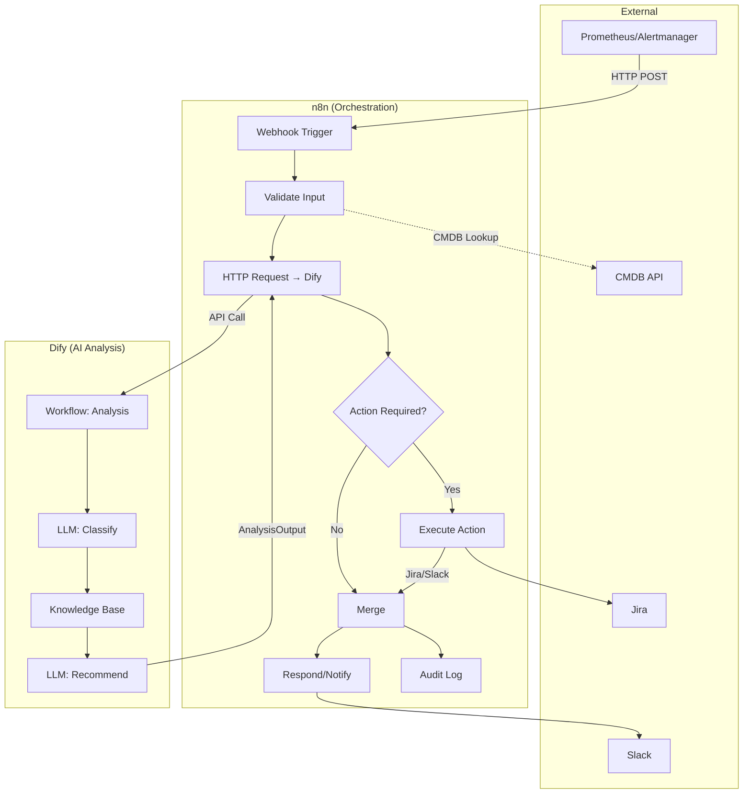

# Módulo 8: Operación, mantenimiento y ciclo de vida

> **Duración:** 2 horas | **Formato:** Teoría (30 min) + Demo (15 min) + Labs (60 min) + Repaso (15 min)

---

## Objetivos del módulo

Al finalizar, los participantes podrán:

- Diferenciar **demo, prototipo, piloto y solución productiva** y aplicar criterios de transición
- Implementar **versionado, documentación técnica y pruebas de regresión** para workflows
- Configurar **monitorización básica** de ejecuciones, errores y tiempos de respuesta
- Definir **métricas técnicas y funcionales** para mejora continua
- Crear **documentación mínima para transferencia** a equipos internos

---

## 8.1 Paso de laboratorio a piloto

### Diferencias entre demo, prototipo, piloto y solución productiva

| Etapa | Objetivo | Audiencia | Datos | Infra | Gobernanza | Duración típica |
|-------|----------|-----------|-------|-------|------------|-----------------|
| **Demo** | Mostrar "art of possible" | Stakeholders, management | Sintéticos, hardcoded | Local / Sandbox | Ninguna | 1-2 sesiones |
| **Prototipo** | Validar viabilidad técnica | Equipo técnico | Ficticios / Anonimizados | Lab (aislado) | Checklist básico | 1-2 sprints |
| **Piloto** | Validar valor en condiciones reales | Usuario real + On-call | **Reales (subset controlado)** | Staging / Prod shadow | Política firmada, aprobaciones | 4-8 semanas |
| **Productivo** | Operación continua | Toda la org | Reales (completos) | Prod (HA, DR) | Gobierno completo, SLA, auditoría | Indefinido |

#### Criterios de transición (Go/No-Go Gates)

| Gate | De → A | Criterios obligatorios (TODOS deben pasar) |
|------|--------|--------------------------------------------|
| **Gate 1** | Demo → Prototipo | Arquitectura definida, riesgos identificados, PoC funcional, equipo asignado |
| **Gate 2** | Prototipo → Piloto | ✅ Checklist Módulo 7 firmado, ✅ Test suite > 80% coverage, ✅ Documentación técnica, ✅ Runbook incidentes, ✅ On-call entrenado, ✅ Métricas baseline definidas |
| **Gate 3** | Piloto → Productivo | ✅ Piloto cumple SLOs 4 semanas, ✅ 0 incidentes severos, ✅ Feedback usuarios > 4/5, ✅ Coste dentro de presupuesto, ✅ Capacidad operativa demostrada, ✅ Plan de capacidad + DR |

> 📝 **Plantilla Go/No-Go (usar en cada gate):**
> ```markdown
> # Go/No-Go Decision: [Proyecto] - [Gate X]
> 
> ## Criterios
> | Criterio | Target | Actual | Pass/Fail | Evidencia |
> |----------|--------|--------|-----------|-----------|
> | Checklist seguridad firmado | 100% | 100% | ✅ | Link doc |
> | Test coverage | >80% | 85% | ✅ | CI report |
> | Latencia P95 | <5s | 3.2s | ✅ | Grafana |
> | Error rate | <1% | 0.3% | ✅ | Grafana |
> | User satisfaction | >4/5 | 4.2/5 | ✅ | Survey |
> 
> ## Decisión
> - [ ] **GO** - Proceder a siguiente etapa
> - [ ] **CONDITIONAL GO** - Con acciones correctivas (listar)
> - [ ] **NO-GO** - Retroceder / Cancelar (justificar)
> 
> ## Firmas
> | Rol | Nombre | Decisión | Fecha |
> |-----|--------|----------|-------|
> | Technical Lead | | | |
> | Platform Lead | | | |
> | Security | | | |
> | Product Owner | | | |
> ```

---

### Versionado de workflows, documentación técnica y pruebas de regresión

#### Estrategia de Versionado (SemVer para Workflows)

```
Formato: MAJOR.MINOR.PATCH [-PRERELEASE] [+BUILD]

Ejemplos:
  v1.0.0          - Primera versión piloto
  v1.1.0          - Nueva feature: soporte multi-namespace
  v1.1.1          - Bugfix: timeout en HTTP Request
  v2.0.0          - Breaking: cambio schema output Dify
  v1.2.0-beta.1   - Pre-release para testing
  v1.2.0+build.42 - Build metadata (CI pipeline)
```

#### Reglas de versionado para n8n/Dify

| Cambio | Versión | Acción |
|--------|---------|--------|
| Bugfix (timeout, typo, logic error) | PATCH | Hotfix branch → main → tag |
| Nueva feature (nuevo nodo, tool, prompt) | MINOR | Feature branch → PR → main → tag |
| Breaking change (schema I/O, auth, node removal) | MAJOR | RFC → Design doc → Migration guide → tag |
| Solo documentación / README | NINGUNA (o PATCH) | Direct commit |
| Configuración entorno (variables, credentials) | NINGUNA | GitOps / Vault (no en workflow JSON) |

#### Estructura de repositorio (GitOps)

```
automation-repo/
├── .github/
│   └── workflows/
│       ├── ci.yml              # Lint, test, validate
│       ├── cd-staging.yml      # Deploy to staging
│       └── cd-prod.yml         # Deploy to prod (manual approval)
├── workflows/
│   ├── alert-classification/
│   │   ├── workflow.json       # n8n workflow export
│   │   ├── version.txt         # v1.2.0
│   │   ├── CHANGELOG.md
│   │   ├── README.md
│   │   ├── tests/
│   │   │   ├── test-cases.json
│   │   │   └── run-tests.sh
│   │   └── docs/
│   │       ├── architecture.md
│   │       ├── runbook.md
│   │       └── api-contract.yaml
│   └── ...
├── dify/
│   ├── incident-analyst/
│   │   ├── app.yaml            # Dify app export (DSL)
│   │   ├── prompts/
│   │   │   ├── system-v1.md
│   │   │   └── system-v2.md
│   │   ├── evaluation/
│   │   │   ├── test-set.json
│   │   │   └── results-v1.2.json
│   │   └── version.txt
│   └── ...
├── contracts/
│   ├── analysis-output.yaml    # JSON Schema compartido
│   └── approval-token.yaml
├── policies/
│   ├── approval-matrix.yaml
│   └── security-policy.md
└── scripts/
    ├── deploy-n8n.sh
    ├── deploy-dify.sh
    └── run-regression.sh
```

#### Pruebas de regresión automatizadas

```bash
#!/bin/bash
# scripts/run-regression.sh

set -euo pipefail

WORKFLOW_DIR="workflows/alert-classification"
TEST_CASES="$WORKFLOW_DIR/tests/test-cases.json"
N8N_URL="${N8N_URL:-https://n8n.staging.lab}"
N8N_API_KEY="${N8N_API_KEY}"

echo "🧪 Running regression tests for $(cat $WORKFLOW_DIR/version.txt)"

# 1. Validate workflow JSON schema
echo "📋 Validating workflow structure..."
npx n8n-cli workflow:validate "$WORKFLOW_DIR/workflow.json"

# 2. Deploy to test environment (staging)
echo "🚀 Deploying to staging..."
./scripts/deploy-n8n.sh staging "$WORKFLOW_DIR/workflow.json"

# 3. Run test cases
echo "🧪 Executing test cases..."
node scripts/run-test-suite.js \
  --url "$N8N_URL" \
  --key "$N8N_API_KEY" \
  --workflow "alert-classification" \
  --tests "$TEST_CASES" \
  --output "test-results-$(date +%s).json"

# 4. Check results
echo "📊 Checking results..."
node scripts/check-test-results.js "test-results-*.json" \
  --min-pass-rate 0.95 \
  --max-latency-p95 5000

echo "✅ Regression tests passed"
```

**Test Case Format (`test-cases.json`):**

```json
[
  {
    "name": "Happy Path - Critical Alert",
    "trigger": "webhook",
    "input": { "alertname": "DiskCritical", "severity": "critical", "instance": "prod-web-01" },
    "expected": {
      "status": "SUCCESS",
      "output_contains": { "recommendation.action_required": true, "recommendation.action_type": "create_ticket" },
      "latency_ms_max": 5000
    }
  },
  {
    "name": "Invalid Input - Missing Severity",
    "trigger": "webhook",
    "input": { "alertname": "Test", "instance": "test-01" },
    "expected": {
      "status": "ERROR",
      "error_code": "VALIDATION_ERROR",
      "latency_ms_max": 2000
    }
  },
  {
    "name": "Dify Timeout Fallback",
    "trigger": "webhook",
    "input": { "alertname": "SlowAlert", "severity": "warning", "instance": "test-01", "_test_delay": 10000 },
    "expected": {
      "status": "SUCCESS",
      "output_contains": { "fallback": true },
      "latency_ms_max": 15000
    }
  }
]
```

---

### Monitorización básica de ejecuciones, errores y tiempos de respuesta

#### Métricas clave (Golden Signals + Business)

| Métrica | Tipo | Target | Alerta | Fuente |
|---------|------|--------|--------|--------|
| **Execution Rate** | Counter | >0 | <1/hr (si esperado >0) | n8n Executions API |
| **Success Rate** | Ratio | >99% | <95% | n8n Executions API |
| **Error Rate** | Ratio | <1% | >5% | n8n Executions API |
| **Latency P50** | Histogram | <2s | >5s | n8n Execution duration |
| **Latency P95** | Histogram | <5s | >10s | n8n Execution duration |
| **Latency P99** | Histogram | <10s | >30s | n8n Execution duration |
| **Queue Depth** | Gauge | <10 | >50 | n8n Queue (BullMQ) |
| **Dify Tokens/Exec** | Histogram | <3000 | >5000 | Dify Analytics / Custom |
| **Dify Latency** | Histogram | <3s | >10s | Dify Analytics / Custom |
| **Approval Pending** | Gauge | 0 | >5 >10min | Custom (approval workflow) |
| **Circuit Breaker Open** | Counter | 0 | >0 | Custom (n8n Function) |

#### Implementación: n8n → Prometheus (Pushgateway / Exporter)

```javascript
// Function node: "Push Metrics to Prometheus" (al final de cada workflow)
const PUSHGATEWAY = process.env.PUSHGATEWAY_URL || 'http://pushgateway:9091'\;
const JOB_NAME = 'n8n_workflows';
const INSTANCE = process.env.HOSTNAME || 'unknown';

const execution = {
  workflow: $workflow.name,
  execution_id: $execution.id,
  status: $execution.status, // 'success' | 'error' | 'crashed'
  duration_ms: $execution.duration,
  trigger: $execution.trigger?.type || 'manual',
  timestamp: new Date().toISOString()
};

// Build Prometheus text format
const metrics = [
  `n8n_execution_total{workflow="${execution.workflow}",status="${execution.status}",trigger="${execution.trigger}",instance="${INSTANCE}"} 1`,
  `n8n_execution_duration_ms{workflow="${execution.workflow}",instance="${INSTANCE}"} ${execution.duration_ms}`,
  `n8n_execution_timestamp{workflow="${execution.workflow}",instance="${INSTANCE}"} ${Date.now()}`
].join('\n') + '\n';

// Push via HTTP Request node (configurado aparte) o Function con fetch
// En Function node real: usar $httpRequest o fetch nativo
return [{ json: { metrics_text: metrics, push_url: `${PUSHGATEWAY}/metrics/job/${JOB_NAME}/instance/${INSTANCE}` } }];
```

#### Dashboard Grafana (Paneles mínimos)

| Panel | Query (PromQL) | Visualización |
|-------|----------------|---------------|
| **Executions/min** | `rate(n8n_execution_total[5m])` | Time series |
| **Success Rate** | `sum(rate(n8n_execution_total{status="success"}[5m])) / sum(rate(n8n_execution_total[5m]))` | Stat + Sparkline |
| **Latency P95** | `histogram_quantile(0.95, rate(n8n_execution_duration_ms_bucket[5m]))` | Time series |
| **Error Breakdown** | `sum by (workflow, error_code) (rate(n8n_execution_total{status="error"}[5m]))` | Bar gauge |
| **Queue Depth** | `n8n_queue_depth` | Gauge |
| **Dify Tokens** | `rate(dify_tokens_total[5m])` | Time series |

---

### Criterios para coste, escalabilidad, disponibilidad y soporte

#### Modelo de Coste (Estimación)

| Componente | Coste Unitario | Estimación Mensual (Piloto) | Notas |
|------------|----------------|----------------------------|-------|
| **n8n Cloud** | $20-120/mes | $50 | O self-hosted: infra ~$30/mes |
| **Dify Cloud** | $59-599/mes | $150 | O self-hosted: GPU ~$200/mes |
| **Modelo IA (OpenAI)** | $/1K tokens | $200-500 | GPT-4o: $5/1M in, $15/1M out |
| **Modelo IA (Local)** | GPU hora | $0 (si own) | Ollama / vLLM en own GPU |
| **Vector DB** | $/GB/mes | $20 | Weaviate Cloud / Pinecone / Self-hosted |
| **Monitoring** | $/host/mes | $50 | Grafana Cloud / Datadog / Self-hosted |
| **Total Piloto** | | **$470-970/mes** | Variable según uso |

> 💡 **Optimización:** Cachear embeddings, usar modelos pequeños para clasificación (GPT-4o-mini), batch requests.

#### Escalabilidad (n8n + Dify)

| Dimensión | Estrategia n8n | Estrategia Dify |
|-----------|----------------|-----------------|
| **Throughput** | Horizontal: Workers + Queue (Redis) | Horizontal: API replicas + Queue (Celery) |
| **Latencia** | Async patterns (webhook On Received) | Streaming response, smaller models |
| **Concurrencia** | Max concurrent executions setting | Max concurrent requests per app |
| **Datos** | External DB (PostgreSQL) | External DB + Vector DB cluster |
| **Archivos** | S3-compatible storage | S3-compatible storage |

#### Disponibilidad (HA/DR)

| Componente | HA Strategy | RPO | RTO |
|------------|-------------|-----|-----|
| **n8n** | 2+ replicas + PostgreSQL HA + Redis Sentinel | 0 (sync DB) | <5 min |
| **Dify** | 2+ API replicas + PostgreSQL HA + Redis + Weaviate cluster | 0 | <10 min |
| **Modelo IA** | Multi-AZ endpoint / Local cluster | N/A | <1 min (failover) |
| **Vector DB** | Weaviate cluster (3+ nodes) | 0 | <5 min |
| **Secrets** | Vault HA (3+ nodes) | 0 | <1 min |

#### Modelo de Soporte

| Nivel | Quién | Horario | SLA Respuesta | Canales |
|-------|-------|---------|---------------|---------|
| **L1 - On-Call** | Platform Engineer (rotativo) | 24/7 | 15 min (P1), 1h (P2) | PagerDuty → Slack → Phone |
| **L2 - Automation Team** | Automation Engineers | Business hours | 4h | Slack #automation-support, Email |
| **L3 - Platform Lead / Vendor** | Platform Lead / n8n/Dify Support | Business hours | 8h | Email, Vendor Portal |
| **Vendor** | n8n Support / Dify Support | Según contrato | Según SLA | Vendor Portal |

---

### Plan de reversión y control de cambios

#### Change Management Process (GitOps + Approval)

```
┌─────────────────────────────────────────────────────────────────────────────┐
│                         CHANGE MANAGEMENT FLOW                              │
│                                                                             │
│  DEVELOPER                                                                  │
│       │                                                                     │
│       ▼                                                                     │
│  Feature Branch → Commits → Push                                            │
│       │                                                                     │
│       ▼                                                                     │
│  CI PIPELINE                                                                │
│  ├── Lint (n8n CLI validate, JSON Schema)                                   │
│  ├── Unit Tests (test-cases.json)                                           │
│  ├── Security Scan (truffleHog, schema validation)                          │
│  └── Build Artifacts (workflow.json, version.txt)                           │
│       │                                                                     │
│       ▼                                                                     │
│  PULL REQUEST                                                               │
│  ├── Reviewers: 2 (1 Platform, 1 Security)                                  │
│  ├── Required Checks: All CI pass                                           │
│  ├── Labels: `type:feature|fix|breaking`, `env:staging|prod`               │
│  └── Auto-merge: No (manual)                                                │
│       │                                                                     │
│       ▼                                                                     │
│  APPROVAL → MERGE TO MAIN                                                   │
│       │                                                                     │
│       ▼                                                                     │
│  CD PIPELINE (Staging)                                                      │
│  ├── Deploy to Staging (n8n + Dify)                                         │
│  ├── Smoke Tests (automated)                                                │
│  ├── Regression Tests (full suite)                                          │
│  └── Notify #automation-deploy                                              │
│       │                                                                     │
│       ▼                                                                     │
│  VALIDATION PERIOD (24-48h)                                                 │
│  ├── Monitor metrics (error rate, latency, business KPIs)                   │
│  ├── User feedback (if pilot)                                               │
│  └── Go/No-Go Decision (Platform Lead)                                      │
│       │                                                                     │
│       ▼                                                                     │
│  CD PIPELINE (Production)                                                   │
│  ├── Manual Approval (Platform Lead + Security)                             │
│  ├── Blue/Green or Canary Deploy                                            │
│  ├── Post-deploy Smoke Tests                                                │
│  └── Rollback Ready (previous version tagged)                               │
└─────────────────────────────────────────────────────────────────────────────┘
```

#### Rollback Procedure (Runbook)

```markdown
# Rollback Procedure: [Workflow/App Name]

## Trigger Conditions
- Error rate > 10% post-deploy (5 min window)
- Latency P95 > 2x baseline
- Critical business metric deviation
- Security incident

## Procedure (Target: < 10 min)

### n8n Workflow Rollback
1. Identify previous stable version: `git tag -l "wf-name-v*" | sort -V | tail -2`
2. In n8n UI: Workflows → [Name] → Import → Select previous `workflow.json`
3. Verify: Active version = previous tag
4. Test: Execute smoke test case
5. Confirm: Metrics recovering in Grafana

### Dify App Rollback
1. In Dify UI: Apps → [Name] → Settings → Version History
2. Restore previous version (DSL import)
2. Verify: Model config, prompts, KB connections intact
3. Test: Run evaluation test suite (quick)
4. Confirm: Groundedness metrics recovering

### Database/Vector DB Rollback (si schema migration)
1. Execute down-migration script (pre-approved, tested)
2. Verify data integrity
3. Restart n8n/Dify pods

## Communication
- Slack #automation-deploy: "ROLLBACK INITIATED: [workflow] vX.Y.Z → vX.Y.W"
- Stakeholders: Email si impacto negocio
- Post-mortem: Programar en 48h

## Verification Checklist
- [ ] Previous version active
- [ ] Smoke test passes
- [ ] Error rate < 1%
- [ ] Latency P95 < baseline
- [ ] Business metrics normal
- [ ] No data loss
```

---

## 8.2 Medición y mejora continua

### Definición de métricas técnicas y funcionales

#### Métricas Técnicas (System Health)

| Métrica | Definición | Target | Frecuencia |
|---------|------------|--------|------------|
| **Availability** | % tiempo workflows respondiendo | 99.9% | Mensual |
| **Reliability** | % ejecuciones exitosas | 99.5% | Semanal |
| **Latency P95** | Tiempo ejecución E2E | <5s | Diario |
| **Throughput** | Ejecuciones/hora pico | Según capacidad | Horario |
| **Error Budget Burn** | % error budget consumido | <50%/mes | Semanal |
| **MTTR** | Tiempo medio recuperación | <30 min | Mensual |
| **Deployment Frequency** | Deploys/semana a prod | >1 | Semanal |
| **Change Failure Rate** | % deploys causando incidente | <10% | Mensual |

#### Métricas Funcionales (Business Value)

| Métrica | Definición | Target | Fuente |
|---------|------------|--------|--------|
| **Automation Rate** | % procesos automatizados vs manuales | >60% | CMDB / Survey |
| **Time Saved** | Horas/hombre ahorradas/mes | >200h | Tracking + Survey |
| **MTTD (Mean Time to Detect)** | Tiempo detección incidente | <5 min | Monitoring |
| **MTTR (Mean Time to Resolve)** | Tiempo resolución incidente | <30 min | Incident Tool |
| **First Contact Resolution** | % tickets resueltos sin escalado | >80% | ITSM |
| **User Satisfaction** | NPS / CSAT usuarios internos | >4/5 | Quarterly Survey |
| **Cost per Execution** | $/ejecución (infra + tokens) | <$0.10 | FinOps |
| **False Positive Rate** | % alertas ruido / total | <20% | Alert Analysis |

---

### Análisis de fallos, falsos positivos y respuestas no útiles

#### Categorización de fallos (Taxonomía)

```yaml
# failure_taxonomy.yaml
categories:
  - code: "INFRA"
    name: "Infraestructura"
    subcategories:
      - "NETWORK_TIMEOUT"
      - "SERVICE_UNAVAILABLE"
      - "RESOURCE_EXHAUSTED"
      - "CONFIG_ERROR"
  
  - code: "INTEGRATION"
    name: "Integración Externa"
    subcategories:
      - "API_CHANGED"
      - "AUTH_EXPIRED"
      - "RATE_LIMITED"
      - "SCHEMA_MISMATCH"
      - "VENDOR_OUTAGE"
  
  - code: "LOGIC"
    name: "Lógica de Negocio"
    subcategories:
      - "VALIDATION_FAILED"
      - "CONDITION_MISMATCH"
      - "DATA_QUALITY"
      - "EDGE_CASE_UNHANDLED"
  
  - code: "AI_MODEL"
    name: "Modelo de IA"
    subcategories:
      - "HALLUCINATION"
      - "LOW_GROUNDEDNESS"
      - "FORMAT_VIOLATION"
      - "CONSTRAINT_VIOLATION"
      - "PROMPT_INJECTION"
      - "TOKEN_LIMIT"
  
  - code: "HUMAN"
    name: "Factor Humano"
    subcategories:
      - "APPROVAL_TIMEOUT"
      - "APPROVAL_REJECTED"
      - "INCORRECT_INPUT"
      - "PROCESS_BYPASS"
```

#### Proceso de análisis (Weekly Failure Review)

```
┌─────────────────────────────────────────────────────────────────────────────┐
│                    WEEKLY FAILURE REVIEW (30 min)                           │
│                                                                             │
│  1. DATA COLLECTION (Automatizado)                                          │
│     ├── Query: Executions last 7d WHERE status=error                        │
│     ├── Group by: failure_category, workflow, environment                   │
│     ├── Top 10 by frequency + Top 5 by impact                               │
│     └── Export: failure-report-YYYY-WW.json                                 │
│                                                                             │
│  2. TRIAGE (15 min)                                                         │
│     ├── Para cada top failure:                                              │
│     │   ├── Root Cause (5 Whys)                                             │
│     │   ├── Impact: usuarios, tiempo, coste                                 │
│     │   ├── Recurrence: primera vez / recurrente / patrón                   │
│     │   └── Owner: quién arregla                                            │
│     │                                                                       │
│     ├── Clasificar acción:                                                  │
│     │   ├── QUICK FIX (config, prompt, threshold) → This sprint            │
│     │   ├── STRUCTURAL FIX (architectura, schema, tool) → Next sprint      │
│     │   ├── MONITOR ONLY (ruido conocido, baja prioridad) → Backlog        │
│     │   └── WONT FIX (edge case extremo, coste > beneficio) → Document     │
│     │                                                                       │
│     └── Asignar tickets en Jira/GitHub con label `failure-review`          │
│                                                                             │
│  3. TRACKING (Continuo)                                                     │
│     ├── Dashboard: "Failure Trends" (4 semanas rolling)                     │
│     ├── KPI: "Mean Time to Fix Failure" (target: < 2 sprints)              │
│     └── Report: Mensual a stakeholders                                      │
└─────────────────────────────────────────────────────────────────────────────┘
```

#### Análisis de Falsos Positivos (Alertas)

| Métrica | Definición | Target | Acción si > target |
|---------|------------|--------|-------------------|
| **False Positive Rate** | Alertas que no requieren acción / Total alertas | <20% | Revisar reglas, ajustar umbrales, enriquecer contexto |
| **Alert Fatigue Index** | Alertas/on-call engineer/turno | <10 | Consolidar, agrupar, routing inteligente |
| **Noise-to-Signal** | Alertas auto-cerradas / Alertas totales | <30% | Mejorar deduplicación, correlación |

---

### Revisión periódica de prompts, documentos y reglas de negocio

#### Calendario de Revisiones (Governance Cadence)

| Frecuencia | Qué revisar | Quién | Output |
|------------|-------------|-------|--------|
| **Semanal** | Fallos, métricas, alertas | On-call + Automation Eng | Failure review notes, tickets |
| **Quincenal** | Prompts Dify (performance, groundedness) | Automation Eng + ML Eng | Prompt version bump, eval results |
| **Mensual** | Documentos KB (expiración, contradicciones) | KB Owners + Automation | KB health report, docs updated |
| **Mensual** | Reglas de negocio (approval matrix, thresholds) | Platform Lead + Business | Policy updates, change requests |
| **Trimestral** | Arquitectura, modelo IA, costes, proveedores | Tech Lead + Finance + Security | Architecture decision record, vendor review |
| **Semestral** | Estrategia automatización, roadmap, skills | Management + Team | Roadmap update, hiring plan |

#### Prompt Review Checklist (Quincenal)

```markdown
# Prompt Review: [App/Workflow] - [Date]

## Current Version
- Prompt Version: v1.2
- Model: gpt-4o-2024-11-20
- Temperature: 0

## Evaluation Results (Last 2 weeks)
| Metric | Target | Actual | Trend |
|--------|--------|--------|-------|
| Format Compliance | 100% | 99.8% | ➡️ |
| Groundedness | >0.9 | 0.92 | ⬆️ |
| Accuracy (vs ground truth) | >85% | 87% | ⬆️ |
| Hallucination Rate | 0% | 0.2% | ➡️ |
| Avg Latency | <3s | 2.4s | ⬇️ |
| Avg Tokens | <2500 | 2,100 | ➡️ |

## Issues Found
1. [ ] Edge case: input con caracteres Unicode → format violation
2. [ ] Contexto: docs v2.0 contradicen v1.5 en sección X
3. [ ] Usuario reporta: respuesta muy verbosa en campo reasoning

## Decisions
- [ ] Bump prompt to v1.3 (fix Unicode handling)
- [ ] Update KB: deprecate v1.5 docs, mark v2.0 as current
- [ ] Add constraint: "reasoning: max 1 sentence"

## Next Review
Date: [+2 weeks]
Owner: [Name]
```

---

### Priorización de nuevas integraciones

#### Framework de Priorización (RICE Adaptado)

| Factor | Definición | Escala (1-10) |
|--------|------------|---------------|
| **Reach** | Cuántos usuarios/procesos afecta | 1=pocos, 10=toda la org |
| **Impact** | Valor negocio si se automatiza (ahorro horas, riesgo) | 1=bajo, 10=crítico |
| **Confidence** | Qué tan seguros estamos de la estimación | 1=adivinanza, 10=datos históricos |
| **Effort** | Semanas-hombre para implementar (inverso) | 1=fácil (1 sem), 10=complejo (3+ mes) |
| **Risk** | Riesgo técnico/seguridad (inverso) | 1=alto riesgo, 10=bajo riesgo |

**Score = (Reach × Impact × Confidence × Risk) / Effort**

#### Pipeline de Integraciones

```
BACKLOG (Ideas) → DISCOVERY (2-4h) → DESIGN (1-2d) → BUILD (1-4w) → VALIDATE (1w) → PILOT (4w) → PROD
     │                │                │              │             │           │         │
     ▼                ▼                ▼              ▼             ▼           ▼         ▼
  Capture:        Validate:       Spec:          Develop:      Test:       Go/No-Go:  Deploy:
  - Source        - Feasibility   - Architecture - n8n/Dify    - Regression - Checklist - GitOps
  - Pain point    - ROI estimate  - Contracts    - Prompts     - Pilot prep - Signatures - Monitor
  - Owner         - Risk assess   - Security     - KB updates  - User test  - Rollback  - Handoff
  - RICE Score    - Data access   - Approval     - Docs        - Metrics    - Plan      - Retire old
```

---

### Documentación mínima para transferencia a equipos internos

#### Paquete de Entrega (Handoff Package)

```
handoff-package/
├── README.md                    # Resumen ejecutivo, quick start
├── ARCHITECTURE.md              # Diagrama + descripción componentes
├── RUNBOOKS/
│   ├── incident-response.md     # Qué hacer si falla
│   ├── deployment.md            # Cómo desplegar/actualizar
│   ├── rollback.md              # Cómo revertir
│   └── scaling.md               # Cómo escalar
├── CONFIGURATION/
│   ├── environments.yaml        # Variables por entorno
│   ├── credentials.md           # Qué credenciales, dónde, rotación
│   └── feature-flags.md         # Flags, defaults, ownership
├── MONITORING/
│   ├── dashboards.json          # Grafana dashboard export
│   ├── alerts.yaml              # Reglas de alerta (PrometheusRule)
│   └── slos.md                  # SLOs definidos, error budgets
├── TESTING/
│   ├── test-cases.json          # Suite de regresión
│   ├── run-tests.sh             # Script ejecución
│   └── test-results-baseline.json
├── SECURITY/
│   ├── threat-model.md          # STRIDE / Data flow diagram
│   ├── approval-matrix.yaml     # Qué requiere aprobación
│   └── data-classification.yaml # Qué datos maneja, retention
├── API/
│   ├── contracts/               # JSON Schemas, OpenAPI specs
│   └── examples/                # Request/Response samples
├── CHANGELOG.md                 # Historial versiones
├── SUPPORT.md                   # Contactos, escalation, vendor info
└── LICENSE.md                   # Uso interno, restricciones
```

#### README.md Template (Mínimo viable)

```markdown
# [Nombre Automatización] - Handoff Document

## 🎯 Qué hace
Automatiza [proceso]: [descripción 1 frase]. 
Entrada: [trigger]. Salida: [acción/notificación].

## 🏗️ Arquitectura
- **Orquestador**: n8n (workflow: `alert-classification-v1.2.0`)
- **IA**: Dify (app: `incident-analyst-v1.1.0`, model: `gpt-4o`)
- **Integraciones**: Prometheus, Jira, Slack, CMDB, KB (Dify)
- **Infra**: Staging/Prod n8n + Dify self-hosted K8s

## 🚀 Quick Start (Staging)
```bash
git clone repo
cd automation/alert-classification
./scripts/deploy.sh staging
./scripts/test-smoke.sh
```

## 📊 Métricas Clave
| Métrica | Target | Actual | Dashboard |
|---------|--------|--------|-----------|
| Success Rate | >99% | 99.7% | [Link] |
| Latency P95 | <5s | 3.2s | [Link] |
| Error Rate | <1% | 0.3% | [Link] |

## 🔐 Credenciales
| Servicio | Entorno | Ubicación | Rotación |
|----------|---------|-----------|----------|
| Jira API | Prod | Vault: `secret/automation/jira` | 90d |
| Slack Bot | Prod | Vault: `secret/automation/slack` | 90d |
| OpenAI | Prod | Vault: `secret/ai/openai` | 60d |

## 🚨 Runbooks
- [Incidente: Workflow falla](modulo-07-seguridad-gobierno.md#lab-71-revisar-un-flujo-inseguro-e-identificar-puntos-de-riesgo)
- [Incidente: Dify alucina](modulo-07-seguridad-gobierno.md#lab-71-revisar-un-flujo-inseguro-e-identificar-puntos-de-riesgo)
- [Rollback](modulo-08-operacion-ciclo-vida.md#rollback-procedure-runbook)

## 👥 Contactos
| Rol | Nombre | Slack | Email | Escalation |
|-----|--------|-------|-------|------------|
| Owner | Juan Pérez | @jperez | juan@company.com | L1 |
| Platform Lead | María García | @mgarcia | maria@company.com | L2 |
| Security | Carlos López | @clopez | carlos@company.com | L3 |

## 📝 Changelog Reciente
- v1.2.0 (2026-01-10): Añadido soporte multi-namespace, fix timeout
- v1.1.1 (2026-01-05): Bugfix validación input
- v1.1.0 (2025-12-20): Nueva feature: enriquecimiento CMDB

---
*Generado automáticamente el 2026-01-15. Versión: 1.2.0*
```

---

## 8.3 Prácticas (Labs)

### Lab 8.1 - Documentar un workflow y sus dependencias

> **Duración:** 25 min | **Generar paquete de handoff mínimo**

#### Entregable: Carpeta `handoff/` para workflow del Lab 6.1

**Estructura mínima a crear:**

```
handoff/alert-classification/
├── README.md                 # Template arriba (rellenar)
├── ARCHITECTURE.md           # Diagrama Mermaid + descripción
├── RUNBOOKS/
│   └── incident-response.md  # Pasos si falla
├── CONFIGURATION/
│   └── environments.yaml     # Variables dev/staging/prod
├── MONITORING/
│   └── key-metrics.md        # Qué métricas, targets, dashboards
├── API/
│   └── contracts/
│       └── analysis-output.yaml  # JSON Schema
└── CHANGELOG.md              # v1.0.0 - Initial pilot version
```

#### ARCHITECTURE.md (Mermaid Diagram)

```markdown
# Architecture: Alert Classification

## Component Diagram



## Data Flow
1. Prometheus alert → n8n Webhook
2. Validate schema → Enrich with CMDB (optional)
3. Call Dify Analysis Workflow (sync, 30s timeout)
4. Dify: Classify → RAG → Recommend → Return JSON
5. n8n: If action_required → Execute (Jira/Slack) → Log
6. Respond to caller / Notify Slack
7. Audit log (structured JSON) → Loki/Elasticsearch

## Failure Modes
| Scenario | Detection | Fallback |
|----------|-----------|----------|
| Dify timeout | n8n HTTP Request timeout | Return cached/fallback response |
| Dify invalid JSON | Schema validation | Log error, return default classification |
| Jira API down | HTTP Request error | Queue for retry, alert on-call |
| CMDB unavailable | HTTP Request error | Continue with defaults, flag enrichment_missing |
```

---

### Lab 8.2 - Crear una matriz de validación antes de piloto

> **Duración:** 20 min | **Go/No-Go Checklist interactivo**

#### Plantilla interactiva (Google Sheet / Excel / Markdown table)

| # | Categoría | Criterio | Target | Método Verificación | Resultado | Evidencia | Owner | Go/No-Go |
|---|-----------|----------|--------|---------------------|-----------|-----------|-------|----------|
| 1 | Seguridad | Credenciales en Vault | 100% | Code review + Vault audit | ☐ Pass / ☐ Fail | Link | Dev | ☐ |
| 2 | Seguridad | Prompt injection detection | Implementado | Test suite | ☐ Pass / ☐ Fail | Link | Dev | ☐ |
| 3 | Seguridad | PII scanning logs | 0 hallazgos | Log sample (100) | ☐ Pass / ☐ Fail | Link | Sec | ☐ |
| 4 | Confiabilidad | Test coverage | >80% | CI report | ☐ Pass / ☐ Fail | Link | Dev | ☐ |
| 5 | Confiabilidad | Regression tests pass | 100% | Test suite run | ☐ Pass / ☐ Fail | Link | Dev | ☐ |
| 6 | Confiabilidad | Latency P95 | <5s | Grafana (7d) | ☐ Pass / ☐ Fail | Link | Platform | ☐ |
| 7 | Confiabilidad | Error rate | <1% | Grafana (7d) | ☐ Pass / ☐ Fail | Link | Platform | ☐ |
| 8 | Observabilidad | Structured logging | 100% steps | Log audit | ☐ Pass / ☐ Fail | Link | Dev | ☐ |
| 9 | Observabilidad | Correlation ID | End-to-end | Trace sample | ☐ Pass / ☐ Fail | Link | Dev | ☐ |
| 10 | Observabilidad | Alertas configuradas | 5 reglas min | PrometheusRule review | ☐ Pass / ☐ Fail | Link | Platform | ☐ |
| 11 | Gobierno | Approval matrix | Documentada + test | Policy doc + test | ☐ Pass / ☐ Fail | Link | Lead | ☐ |
| 12 | Gobierno | RBAC configurado | n8n + Dify | Access review | ☐ Pass / ☐ Fail | Link | Sec | ☐ |
| 13 | Gobierno | Documentación técnica | Completa | Handoff package | ☐ Pass / ☐ Fail | Link | Dev | ☐ |
| 14 | Gobierno | Runbook incidentes | Probado | Drill realizado | ☐ Pass / ☐ Fail | Link | Lead | ☐ |
| 15 | Gobierno | Rollback plan | <10 min | Drill realizado | ☐ Pass / ☐ Fail | Link | Lead | ☐ |
| 16 | Calidad IA | Groundedness | >0.9 | Eval suite | ☐ Pass / ☐ Fail | Link | Dev | ☐ |
| 17 | Calidad IA | Format compliance | 100% | Eval suite | ☐ Pass / ☐ Fail | Link | Dev | ☐ |
| 18 | Calidad IA | Model version pinned | Sí | Config audit | ☐ Pass / ☐ Fail | Link | Dev | ☐ |
| 19 | Operación | On-call entrenado | 100% team | Training record | ☐ Pass / ☐ Fail | Link | Lead | ☐ |
| 20 | Operación | Coste estimado | < budget | FinOps model | ☐ Pass / ☐ Fail | Link | Finance | ☐ |
| 21 | Legal | Data residency | EU | Infra audit | ☐ Pass / ☐ Fail | Link | Legal | ☐ |
| 22 | Legal | Vendor DPA | Firmado | Legal review | ☐ Pass / ☐ Fail | Link | Legal | ☐ |

**Decisión Final:**
- [ ] **GO** - Todos Pass
- [ ] **CONDITIONAL GO** - Items Fail con plan mitigación (listar)
- [ ] **NO-GO** - Items Fail críticos sin mitigación

---

### Lab 8.3 - Definir métricas de éxito y criterios de parada

> **Duración:** 15 min | **Definir SLOs y Error Budgets**

#### Ejercicio: Para el workflow del Lab 6.1, definid:

**1. Service Level Objectives (SLOs)**

| SLO | SLI (Service Level Indicator) | Target | Ventana | Consecuencia si breach |
|-----|-------------------------------|--------|---------|------------------------|
| Disponibilidad | % ejecuciones exitosas / total | 99.5% | 30 días | Freeze changes, priorizar fix |
| Latencia | P95 duración ejecución | <5s | 7 días | Investigar, optimizar |
| Calidad IA | Groundedness score | >0.9 | 7 días | Revisar prompts/KB |
| Throughput | Ejecuciones/hora (pico) | >50 | 1 día | Escalar workers |

**2. Error Budget Policy**

```yaml
# error-budget-policy.yaml
service: alert-classification
slos:
  - name: availability
    target: 0.995
    window: 30d
    error_budget: 0.005  # 0.5% = ~3.6h downtime/mes
    alert_thresholds:
      - level: "warning"
        burn_rate: 2x    # Consumiendo 2x budget normal
        action: "notify_team"
      - level: "critical"
        burn_rate: 10x   # Consumiendo 10x budget
        action: "freeze_deploys + page_oncall"
  - name: latency_p95
    target: 5000  # ms
    window: 7d
    error_budget: 0.05  # 5% requests > 5s
    alert_thresholds:
      - level: "warning"
        burn_rate: 3x
        action: "notify_team"
      - level: "critical"
        burn_rate: 10x
        action: "investigate_root_cause"
```

**3. Criterios de Parada (Stop Criteria para Piloto)**

| Criterio | Umbral | Acción |
|----------|--------|--------|
| **Error Rate** | >10% por 1 hora | Parar piloto, investigar, rollback |
| **Latencia P99** | >60s sostenido 15 min | Parar, escalar infra, revisar Dify |
| **Seguridad** | Cualquier incidente severo | Parar inmediato, post-mortem 24h |
| **Calidad IA** | Groundedness < 0.7 por 1 hora | Deshabilitar IA, modo fallback determinista |
| **Coste** | >2x presupuesto mensual | Revisar modelo/tokens, optimizar o parar |
| **Usuario** | Satisfacción < 2/5 (encuesta) | Pausar, feedback sessions, rediseñar |

**4. Definición de Done (Piloto Exitoso)**

- [ ] 4 semanas consecutivas cumpliendo todos los SLOs
- [ ] 0 incidentes severidad P1/P2 atribuibles a la automatización
- [ ] Feedback usuarios ≥ 4/5 (mínimo 10 respuestas)
- [ ] Coste real ≤ 1.2x estimado
- [ ] Documentación completa + handoff package aprobado
- [ ] Equipo on-call autónomo (simulacro resuelto sin ayuda dev)
- [ ] Go/No-Go Gate 3 firmado por Platform Lead + Security + Product Owner

---

## Resumen del Módulo 8

| Concepto | Clave |
|----------|-------|
| **Etapas** | Demo → Prototipo → Piloto → Productivo (Gates formales) |
| **Versionado** | SemVer estricto, GitOps, CHANGELOG, tags |
| **Regresión** | Test cases JSON, CI/CD automatizado, deploy staging → prod |
| **Monitoring** | Golden Signals + Business metrics, Grafana dashboards, Alertas |
| **Coste/Escalabilidad/HA** | Modelo de coste, scaling strategies, RPO/RTO definidos |
| **Change Management** | PR + CI + Staging validation + Manual prod approval + Rollback ready |
| **Mejora Continua** | Failure taxonomy, Weekly review, Prompt/KB/Rule cadence |
| **Priorización** | RICE adaptado, Pipeline Discovery→Design→Build→Validate→Pilot→Prod |
| **Handoff** | Paquete estándar: README, Arch, Runbooks, Config, Monitoring, API, Security, Changelog |
| **SLOs/Error Budgets** | Definidos, medidos, con alertas de burn rate y criterios de parada |

---

## 🔗 Siguiente: [Módulo 9: Caso práctico final integrado](modulo-09-caso-final.md)

> **Preparad:** Todos los workflows/apps de labs previos, entorno de integración completo, datos de prueba end-to-end, stakeholders para revisión final.
