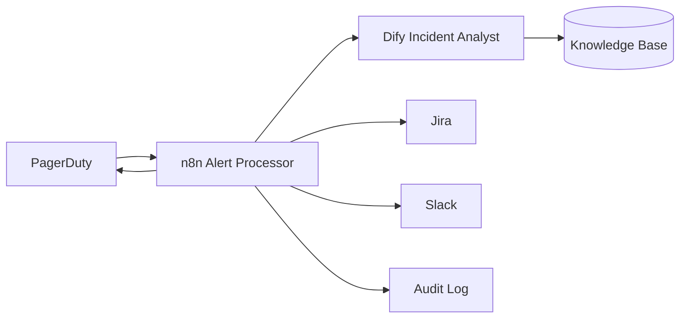

# Módulo 9: Caso práctico final integrado

> **Duración:** 3 horas | **Formato:** Briefing (15 min) + Build (120 min) + Validación (45 min) + Presentación + Retro (30 min)

---

## Objetivos del módulo

Al finalizar, los participantes habrán:

- Construido un **prototipo integrado end-to-end** combinando n8n + Dify + RAG + Agentes
- Aplicado **todos los conceptos** del curso: automatización determinista, IA, seguridad, observabilidad, gobernanza
- Validado el prototipo contra **casos normales, edge cases y fallos**
- Identificado **riesgos, deuda técnica y siguientes pasos** para piloto controlado
- Presentado la solución a "stakeholders" (resto de la clase) con evidencia

---

## 9.1 Escenario propuesto

### Contexto de negocio

> **Empresa:** TechCorp - Plataforma SaaS B2B (microservicios en Kubernetes multi-cloud)
> 
> **Equipo:** Platform Engineering (12 personas) - Responsables de fiabilidad, despliegues, observabilidad
> 
> **Dolor actual:** 
> - 50+ alertas/día de Prometheus (ruido alto, fatiga)
> - Tiempo medio clasificación manual: 15 min/alerta
> - Escalados innecesarios a on-call (falsos positivos ~40%)
> - Conocimiento tribal en runbooks Confluence (desactualizados, difíciles de encontrar)
> - Sin trazabilidad de decisiones de escalado

### Objetivo del prototipo

> **Automatizar el ciclo completo de vida de una alerta:**
> 1. **Recibir** alerta de Prometheus/Alertmanager
> 2. **Enriquecer** con contexto (CMDB, deployments recientes, runbooks)
> 3. **Analizar** con IA (clasificación, causa raíz probable, recomendación)
> 4. **Decidir** acción: auto-resolver / crear ticket / escalar a on-call
> 5. **Ejecutar** acción con aprobación si requerida
> 6. **Registrar** todo para auditoría y mejora continua

### Arquitectura objetivo (Target State)

```
┌─────────────────────────────────────────────────────────────────────────────────────┐
│                        ALERT LIFECYCLE AUTOMATION                                   │
│                                                                                     │
│  PROMETHEUS                                                                         │
│     │                                                                               │
│     ▼                                                                               │
│  ┌─────────────────────────────────────────────────────────────────────────────┐   │
│  │                           N8N WORKFLOW: "Alert Processor v1.0"              │   │
│  │                                                                             │   │
│  │  ┌─────────┐  ┌──────────┐  ┌──────────┐  ┌─────────┐  ┌──────────────┐   │   │
│  │  │ Webhook │─▶│ Validate │─▶│ Enrich   │─▶│ Dify    │─▶│ Decision &   │   │   │
│  │  │ Trigger │  │ + Sanit. │  │ (CMDB,   │  │ Analysis│  │ Execution    │   │   │
│  │  └─────────┘  └──────────┘  │ Deploy,  │  │ Workflow│  │ (IF/Switch/  │   │   │
│  │                             │ Runbook) │  └────┬────┘  │  Approval)   │   │   │
│  │                             └──────────┘       │       └──────┬───────┘   │   │
│  │                                                  │              │           │   │
│  │                              ┌───────────────────┼──────────────┼───────┐   │   │
│  │                              ▼                   ▼              ▼       ▼   │   │
│  │                         ┌─────────┐         ┌─────────┐  ┌─────────┐ ┌────┐  │   │
│  │                         │ Auto-   │         │ Create  │  │ Escalate│ │Log │  │   │
│  │                         │ Resolve │         │ Ticket  │  │ to      │ │Only│  │   │
│  │                         │ (restart│         │ (Jira)  │  │ On-Call │ │    │  │   │
│  │                         │  pod,   │         │         │  │ (PagerD)│ │    │  │   │
│  │                         │  scale) │         │         │  │         │ │    │  │   │
│  │                         └────┬────┘         └────┬────┘  └────┬────┘ └──┬─┘   │   │
│  │                              │                   │          │         │       │   │
│  │                              └───────────────────┼──────────┼─────────┘       │   │
│  │                                                  ▼          ▼                 │   │
│  │                                         ┌─────────────────────┐               │   │
│  │                                         │   MERGE + AUDIT     │               │   │
│  │                                         │   (Structured Log)  │               │   │
│  │                                         └──────────┬──────────┘               │   │
│  │                                                    │                        │   │
│  │                                                    ▼                        │   │
│  │                                         ┌─────────────────────┐               │   │
│  │                                         │   NOTIFICATIONS     │               │   │
│  │                                         │   (Slack, Email)    │               │   │
│  │                                         └─────────────────────┘               │   │
│  └─────────────────────────────────────────────────────────────────────────────┘   │
│                                                    │                                │
│                                                    ▼                                │
│  ┌─────────────────────────────────────────────────────────────────────────────┐   │
│  │                           DIFY: "Incident Analyst v1.0"                     │   │
│  │  ┌─────────────┐  ┌─────────────┐  ┌─────────────┐  ┌─────────────────┐    │   │
│  │  │ Knowledge   │  │ LLM:        │  │ LLM:        │  │ Output:         │    │   │
│  │  │ Base:       │  │ Classify    │  │ Recommend   │  │ AnalysisOutput  │    │   │
│  │  │ Runbooks,   │  │ + Enrich    │  │ (Structured)│  │ (JSON Schema)   │    │   │
│  │  │ Arch, FAQs  │  │             │  │             │  │                 │    │   │
│  │  └─────────────┘  └─────────────┘  └─────────────┘  └─────────────────┘    │   │
│  └─────────────────────────────────────────────────────────────────────────────┘   │
│                                                    │                                │
│                                                    ▼                                │
│  ┌─────────────────────────────────────────────────────────────────────────────┐   │
│  │                         OBSERVABILITY STACK                                 │   │
│  │  ┌──────────┐  ┌──────────┐  ┌──────────┐  ┌──────────┐  ┌──────────┐     │   │
│  │  │ Grafana  │  │ Prometheus│  │ Loki     │  │ Alerting │  │ Tracing  │     │   │
│  │  │ Dashboards│  │ Metrics  │  │ Logs     │  │ Rules    │  │ (Jaeger) │     │   │
│  │  └──────────┘  └──────────┘  └──────────┘  └──────────┘  └──────────┘     │   │
│  └─────────────────────────────────────────────────────────────────────────────┘   │
└─────────────────────────────────────────────────────────────────────────────────────┘
```

---

## 9.2 Construcción del prototipo

### Fase 1: Preparación (15 min) - Ya hecha en labs previos

**Checklist de prerequisitos (verificar en clase):**

- [ ] n8n accesible + credenciales configuradas (Jira, Slack, CMDB mock, Dify API)
- [ ] Dify accesible + Knowledge Base "Tech Docs" indexada (Lab 5) + App "Incident Analyst" (Lab 4/6)
- [ ] Dify Workflow "Alert Analysis" publicado como API (Lab 6)
- [ ] Mock APIs funcionando: CMDB, Deployments, Runbooks, Jira, Slack (httpbin/webhook.site)
- [ ] Datos de prueba: 10 alertas variadas (critical, warning, info, falsos positivos)
- [ ] Git repo clonado + rama `feature/final-prototype` creada

### Fase 2: Build n8n Workflow "Alert Processor" (60 min)

#### Estructura de nodos (construir en orden)

```
1. WEBHOOK TRIGGER
   Path: /webhook/alerts/processor
   Method: POST
   Response Mode: On Received (async) → Respond 202 immediately
   Auth: Header X-TechCorp-Token (HMAC validation in Function node)

2. FUNCTION: "Validate HMAC & Parse"
   - Verify HMAC signature
   - Parse JSON body
   - Generate correlation_id: corr-{{ $now.format('yyyyMMddHHmmssSSS') }}
   - Sanitize for logging

3. FUNCTION: "Validate Alert Schema" (AJV)
   Required: alertname, instance, severity, namespace, pod
   Enum severity: critical, warning, info
   Output: valid=true/false, errors[]

4. IF: "Valid Alert?"
   True → Continue
   False → Set Error Response → Slack Alert (malformed) → END

5. HTTP REQUEST: "Enrich - CMDB Lookup"
   URL: {{ $vars.CMDB_API }}/hosts/{{ $json.instance }}
   Auth: Header Auth (CMDB credentials)
   Timeout: 5000, Retry: 2x
   Error → Set fallback: { owner_team: "unknown", environment: "unknown" }

6. HTTP REQUEST: "Enrich - Recent Deployments"
   URL: {{ $vars.DEPLOY_API }}/services/{{ $json.service }}/deployments?hours=24
   Output: Array of deployments (version, time, author, changes)

7. HTTP REQUEST: "Enrich - Runbook Lookup"
   URL: {{ $vars.RUNBOOK_API }}/search?alert={{ $json.alertname }}
   Output: Best match runbook (title, url, steps_summary)

8. SET: "Build Dify Input"
   Combine: original_alert + cmdb_data + deployments + runbook
   Format per Dify Analysis Workflow contract

9. HTTP REQUEST: "Call Dify Analysis"
   URL: {{ $vars.DIFY_API }}/workflows/run
   Method: POST
   Headers: Authorization: Bearer {{ $credentials.difyApiKey }}, Content-Type: application/json
   Body: { "inputs": { "alert_json": ..., "cmdb_data": ..., "runbook_summary": ... }, "response_mode": "blocking" }
   Timeout: 60000, Retry: 2x (on 5xx/timeout)
   Error → Set fallback analysis (rule-based) → Continue

10. FUNCTION: "Validate Dify Output Schema" (AJV against AnalysisOutput contract)
    Success → Continue
    Error → Log validation error, use fallback analysis → Continue

11. FUNCTION: "Safety Gate" (Module 6)
    Check: confidence, action_type allowed, approval_required for prod
    Output: safety_check { passed, errors[], warnings[] }

12. IF: "Safety Check Passed?"
    True → Continue
    False → Log violation, Alert Security Slack, Set "requires_manual_review" → Continue to Decision

13. SWITCH: "Decision Router" (based on recommendation.action_type)
    Cases:
    - "auto_resolve" → Branch A
    - "create_ticket" → Branch B
    - "restart_pod" → Branch C
    - "scale_deployment" → Branch D
    - "escalate_oncall" → Branch E
    - "investigate" → Branch F
    - Default → Branch F (investigate)

14. BRANCH A: "Auto Resolve" (no approval needed)
    - HTTP Request: Execute action (restart/scale) via n8n action webhook
    - Verify result (health check)
    - Set execution_result

15. BRANCH B: "Create Ticket" (no approval needed)
    - HTTP Request: Jira Create Issue (structured from analysis)
    - Set execution_result with ticket_key

16. BRANCH C/D: "Restart Pod / Scale Deployment" (REQUIRES APPROVAL)
    - IF: approval_required == true
      - True → HTTP Request: Request Approval (n8n approval webhook) → WAIT for callback (10min TTL)
      - False → Continue
    - On Approval: HTTP Request: Execute Action → Verify → Set result
    - On Reject/Timeout: Set result { status: "rejected", reason: "..." }

17. BRANCH E: "Escalate On-Call"
    - HTTP Request: PagerDuty Create Incident (high urgency)
    - Slack: Post to #oncall with analysis summary + actions
    - Set execution_result

18. BRANCH F: "Investigate Only"
    - Set execution_result { status: "investigate", reason: "Low confidence / complex" }
    - Slack: Post to #platform-investigations

19. MERGE: "Merge Results" (Wait mode - all branches converge)

20. SET: "Build Final Audit Record"
    Combine: correlation_id, original_alert, enrichment, analysis, decision, execution_result, timestamps, durations

21. HTTP REQUEST: "Write Audit Log"
    URL: {{ $vars.AUDIT_API }}/events
    Method: POST
    Body: Audit record (structured JSON)

22. SLACK: "Notify Result" (to appropriate channel based on action)
    Format: Structured Block Kit with correlation_id, status, key findings, links

23. ERROR TRIGGER (Global)
    - Catch any unhandled error
    - Build error audit record
    - Alert #platform-alerts (PagerDuty if critical)
    - Respond to webhook with error (if sync) or log
```

#### Configuración de variables de entorno (n8n Workflow Variables)

```yaml
# Settings → Workflow Variables
CMDB_API: "https://cmdb.mock.lab/api/v1"
DEPLOY_API: "https://deploy.mock.lab/api/v1"
RUNBOOK_API: "https://runbook.mock.lab/api/v1"
DIFY_API: "https://dify.lab/v1"
AUDIT_API: "https://audit.mock.lab/api/v1"
APPROVAL_WEBHOOK: "https://n8n.lab/webhook/approval/request"
MAX_EXECUTION_TIME_MS: 120000
DEFAULT_TIMEOUT_MS: 30000
```

### Fase 3: Dify Workflow "Alert Analysis" (30 min) - Refinar del Lab 6

#### Nodos del Workflow Dify

```
START: Inputs
  - alert_json (object, required)
  - cmdb_data (object, optional)
  - deployment_history (array, optional)
  - runbook_summary (string, optional)

LLM NODE 1: "Classify & Enrich"
  System Prompt: (Ver Module 4/6 - Incident Analyst role)
  Variables: All inputs
  Output Schema: Classification + Enrichment partial
  Model: gpt-4o, temp=0, max_tokens=2000

KNOWLEDGE RETRIEVAL: "Relevant Runbooks"
  Knowledge Base: Tech Docs
  Query: {{ alert_json.alertname }} {{ alert_json.severity }} {{ cmdb_data.service }}
  Top K: 5, Hybrid, Rerank: enabled
  Output Variable: retrieved_runbooks

LLM NODE 2: "Root Cause Analysis"
  System Prompt: "Analyze alert + context + runbooks. Identify probable root cause. Cite sources."
  Variables: Classification + Enrichment + retrieved_runbooks
  Output Schema: RootCause { cause, confidence, evidence[], contributing_factors[] }
  Model: gpt-4o, temp=0

LLM NODE 3: "Recommendation Engine"
  System Prompt: "Based on classification, root cause, runbooks, recommend action. Follow decision matrix."
  Variables: All previous outputs
  Output Schema: Recommendation (action_required, action_type, action_params, requires_approval, approval_reason, reasoning)
  Model: gpt-4o, temp=0

CODE NODE: "Combine & Validate"
  Python/JS: Merge all outputs → AnalysisOutput schema
  Validate: confidence thresholds, required fields, action_type enum
  If validation fails: Apply defaults, flag warnings

END: Output AnalysisOutput (JSON)
```

#### Prompt crítico: Decision Matrix (en LLM Node 3)

```markdown
# DECISION MATRIX (OBLIGATORIO SEGUIR)

IF classification.priority == "P1" AND classification.category == "infrastructure":
  - action_type: "restart_pod" OR "scale_deployment" (según root_cause)
  - requires_approval: TRUE (si environment == "production")
  - approval_reason: "Reinicio/escala en producción por incidente P1"

IF classification.priority == "P1" AND classification.category == "security":
  - action_type: "escalate_oncall"
  - requires_approval: FALSE (auto-escalar)
  - approval_reason: "Incidente seguridad - escalado inmediato"

IF classification.priority == "P2" AND root_cause.confidence > 0.8:
  - action_type: "create_ticket" (con runbook steps)
  - requires_approval: FALSE

IF classification.priority IN ["P3", "P4"]:
  - action_type: "create_ticket" (baja prioridad)
  - requires_approval: FALSE

IF root_cause.confidence < 0.6 OR classification.confidence < 0.7:
  - action_type: "investigate"
  - requires_approval: FALSE
  - reasoning: "Confianza insuficiente para acción automática. Requiere análisis humano."

DEFAULT:
  - action_type: "investigate"
  - requires_approval: FALSE
```

### Fase 4: Integración y Pruebas (15 min)

#### Test Cases a ejecutar (mínimo 5)

| # | Alerta | Expected Flow | Validación |
|---|--------|---------------|------------|
| 1 | `PodOOMKilled` critical, prod, recent deploy | Enrich → Dify P1 → restart_pod → Approval → Execute → Ticket + Slack | Approval requested, executed, verified |
| 2 | `HighCPU` warning, staging, no deploy | Enrich → Dify P3 → create_ticket (no approval) → Slack | Ticket created, no approval |
| 3 | `DiskPressure` critical, prod, no runbook | Enrich → Dify P1 → investigate (low confidence) → Slack #investigations | No auto-action, flagged |
| 4 | `FailedMount` warning, prod, known issue | Enrich → Dify P2 → create_ticket + runbook link → Slack | Ticket with runbook |
| 5 | Malformed JSON (missing severity) | Validate → Error → Slack alert malformed → 400 response | Proper error handling |

---

## 9.3 Validación, presentación y siguientes pasos

### Validación guiada (45 min)

#### Checklist de validación por equipos (parejas se validan mutuamente)

| Área | Test | Pass/Fail | Evidencia |
|------|------|-----------|-----------|
| **Entrada** | Webhook recibe alerta real (curl/Postman) | ☐ | Correlation ID generado |
| **Validación** | Alerta inválida → 400 + error estructurado | ☐ | Log + Slack |
| **Enriquecimiento** | CMDB/Deploy/Runbook datos en Dify input | ☐ | Dify execution log |
| **Análisis Dify** | Output AnalysisOutput válido (schema) | ☐ | JSON output |
| **Clasificación** | Priority correcta según matriz | ☐ | Comparar con ground truth |
| **Recomendación** | Action_type coherente con decision matrix | ☐ | Revisar reasoning |
| **Safety Gate** | Bloquea acción insegura (test: delete action) | ☐ | Violation logged |
| **Aprobación** | Prod action → Slack approval → Callback → Execute | ☐ | Approval record |
| **Ejecución** | Action ejecutada (mock) → Resultado verificado | ☐ | Execution result |
| **Auditoría** | Audit log completo en endpoint | ☐ | Audit API response |
| **Notificación** | Slack mensaje correcto por canal | ☐ | Slack channel |
| **Trazabilidad** | Correlation ID en TODO (logs, audit, Slack) | ☐ | Buscar en Loki |
| **Error Handling** | Dify timeout → Fallback → Continue | ☐ | Simular delay 70s |
| **Error Handling** | Jira API down → Queue + Alert | ☐ | Simular 503 |
| **Rendimiento** | Latencia E2E < 30s (P95) | ☐ | 5 ejecuciones |

#### Ground Truth para validación (Clave de respuestas)

```json
// test-ground-truth.json
[
  {
    "alert": { "alertname": "PodOOMKilled", "severity": "critical", "environment": "production" },
    "expected": {
      "classification": { "priority": "P1", "category": "infrastructure", "confidence_min": 0.85 },
      "recommendation": { "action_type": "restart_pod", "requires_approval": true },
      "root_cause": { "cause_contains": "memory limit", "confidence_min": 0.7 }
    }
  },
  {
    "alert": { "alertname": "HighCPU", "severity": "warning", "environment": "staging" },
    "expected": {
      "classification": { "priority": "P3", "category": "performance", "confidence_min": 0.8 },
      "recommendation": { "action_type": "create_ticket", "requires_approval": false }
    }
  },
  {
    "alert": { "alertname": "DiskPressure", "severity": "critical", "environment": "production", "no_runbook": true },
    "expected": {
      "classification": { "priority": "P1", "category": "infrastructure" },
      "recommendation": { "action_type": "investigate", "requires_approval": false }
    }
  }
]
```

---

### Presentación final (30 min) - Formato "Demo Day"

#### Estructura de presentación (5 min por equipo)

| Sección | Tiempo | Contenido |
|---------|--------|-----------|
| **1. Problema** | 30s | Qué dolor resuelve, métricas baseline |
| **2. Arquitectura** | 1 min | Diagrama + decisiones clave (por qué n8n + Dify) |
| **3. Demo en vivo** | 2 min | Ejecutar 1 caso happy path + 1 edge case |
| **4. Seguridad/Gobernanza** | 30s | Approval gate, safety gate, audit log, secret management |
| **5. Observabilidad** | 30s | Dashboard Grafana + Correlation ID trace |
| **6. Riesgos y Deuda** | 30s | Top 3 riesgos, qué no está listo para piloto |
| **7. Próximos pasos** | 30s | Plan para piloto (Gate 2 checklist) |

#### Plantilla de diapositivas (Markdown → Marp/Reveal.js)

```markdown
# Alert Lifecycle Automation - Prototipo Final

## Equipo: [Nombres]

---

### Problema
- 50 alertas/día → 12.5h/semana clasificación manual
- 40% falsos positivos → Fatiga on-call
- Runbooks desactualizados → Conocimiento tribal
- Sin trazabilidad decisiones

---

### Arquitectura


---

### Demo
1. **Happy Path**: PodOOMKilled prod → restart_pod con aprobación
2. **Edge Case**: Alerta sin runbook → investigate + Slack

---

### Seguridad
- ✅ Credenciales en Vault/n8n Credentials
- ✅ HMAC validation en webhook
- ✅ Safety Gate: valida confidence, action_type, approval
- ✅ Approval Gate: JWT token, TTL 10min, Slack callback
- ✅ Audit Log: Correlation ID end-to-end, append-only

---

### Observabilidad
- **Dashboard**: Executions/min, Success Rate, Latency P95, Error Breakdown
- **Tracing**: Correlation ID en Loki (logs) + Jaeger (traces)
- **Alertas**: Error rate >5%, Latency P95 >10s, Approval pending >10min

---

### Riesgos y Deuda Técnica
| Riesgo | Impacto | Mitigación |
|--------|---------|------------|
| Dify latency variable (2-15s) | SLA breach | Async pattern, fallback sync |
| KB runbooks 30% outdated | Malas recomendaciones | Review mensual owners |
| Approval bottleneck (solo 2 approvers) | Delay P1 | Ampliar pool, auto-approve staging |

---

### Próximos Pasos (Piloto - 4 semanas)
- [ ] Gate 2 Checklist completo (Seguridad, Tests, Docs, Runbooks)
- [ ] Entrenar on-call (2 sesiones + simulacro)
- [ ] Shadow mode 2 semanas (solo log, no action)
- [ ] Métricas baseline: MTTD, MTTR, False Positive Rate
- [ ] Go/No-Go Gate 3 decisión
```

---

### Retrospectiva del curso (15 min)

#### Formato: Start / Stop / Continue (por equipos, luego compartir)

| Categoría | Preguntas |
|-----------|-----------|
| **START** | Qué deberíamos empezar a hacer en nuestros equipos mañana |
| **STOP** | Qué prácticas actuales deberíamos dejar (manual, riesgosas) |
| **CONTINUE** | Qué del curso funciona y debemos mantener/expandir |

#### Action Items Personales (Compromiso individual)

Cada participante escribe 3 acciones concretas para los próximos 30 días:

1. **Acción técnica**: _________________________________ (ej. "Migrar 1 workflow crítico a n8n con approval gate")
2. **Acción de conocimiento**: _________________________________ (ej. "Documentar 3 runbooks en KB Dify")
3. **Acción cultural**: _________________________________ (ej. "Proponer revisión mensual de falsos positivos en retro de equipo")

---

## Entregables finales del curso (por participante)

| Entregable | Formato | Dónde | Deadline |
|------------|---------|-------|----------|
| **Workflow n8n exportado** | `workflow.json` | Git repo / Shared drive | Fin de clase |
| **Dify App/Workflow export** | `app.yaml` / `workflow.dsl.yaml` | Git repo / Shared drive | Fin de clase |
| **Handoff Package** | Carpeta `handoff/` completa | Git repo | +1 semana |
| **Test Suite** | `test-cases.json` + resultados | Git repo | +1 semana |
| **Action Items Personales** | Documento 1-página | Entregar a instructor | Fin de clase |
| **Feedback Curso** | Formulario anónimo | Link proporcionado | +3 días |

---

## Recursos post-curso (Continuar aprendiendo)

### Comunidades y Soporte
- **n8n Community**: https://community.n8n.io/ (Muy activo, workflows compartidos)
- **Dify Discord/GitHub**: https://github.com/langgenius/dify/discussions
- **Curso Repo**: [GitHub Classroom Link] - Todos los labs, soluciones, templates

### Certificación y Próximos Niveles
- **n8n Certification**: https://n8n.io/certification (Gratuito, valida skills)
- **Dify Advanced**: Workshops mensuales (anunciados en Discord)
- **Platform Engineering Slack**: #automation-coworking (jueves 16h)

### Lecturas Recomendadas
- *Building LLM Applications for Production* - Chip Huyen
- *Designing Machine Learning Systems* - Chip Huyen
- *Site Reliability Engineering* - Google (Cap. Monitoring, Alerting, On-call)
- *Team Topologies* - Matthew Skelton & Manuel Pais (Para organización de equipos)

---

## ¡Felicidades! 🎉

> **Habéis completado 18 horas de formación intensiva en automatización y agentes sin código.**
> 
> **Ahora tenéis las herramientas, patrones y criterios para:**
> - ✅ Transformar procesos manuales en workflows auditable
> - ✅ Aplicar IA de forma segura y controlada (RAG, Agents, Guardrails)
> - ✅ Orquestar n8n + Dify con gobernanza técnica
> - ✅ Pasar de prototipo a piloto con confianza
> 
> **El siguiente paso es vuestro: ¡Automatizad con criterio!**

---

## Apéndice: Referencia Rápida de Comandos y Expresiones

### n8n Expresiones Útiles
```javascript
// Fecha actual ISO
{{ $now.toISOString() }}

// Timestamp para IDs
{{ $now.format('yyyyMMddHHmmssSSS') }}

// Acceso a campo con default
{{ $json.field ?? 'default' }}

// Condicional inline
{{ $json.severity === 'critical' ? 'P1' : 'P3' }}

// Referencia a otro nodo
{{ $('HTTP Request').item.json.field }}

// JSON stringify para logging
{{ JSON.stringify($json, null, 2) }}

// Hash SHA256 (para correlation IDs)
{{ $sha256('string') }}

// Random string (para IDs temporales)
{{ $randomString(16) }}
```

### Dify API Endpoints Clave
```bash
# Run Workflow (blocking)
POST /v1/workflows/run
{ "inputs": {...}, "response_mode": "blocking" }

# Run Chat App
POST /v1/chat-messages
{ "inputs": {...}, "query": "user question", "response_mode": "blocking" }

# Upload Document to KB
POST /datasets/{id}/documents
multipart/form-data: file + data={indexing_technique: "high_quality"}

# Search KB
POST /datasets/{id}/retrieve
{ "query": "text", "top_k": 5, "score_threshold": 0.6 }
```

### GitOps Commands
```bash
# Tag version
git tag -a v1.2.0 -m "Release v1.2.0: Multi-namespace support"
git push origin v1.2.0

# Deploy staging
./scripts/deploy-n8n.sh staging workflows/alert-classification/workflow.json

# Run regression
./scripts/run-regression.sh workflows/alert-classification

# Rollback
git checkout v1.1.1 -- workflows/alert-classification/workflow.json
./scripts/deploy-n8n.sh prod workflows/alert-classification/workflow.json
```

---

*Fin del Curso: Automatización y agentes sin código para perfiles técnicos*
*Versión 1.0 - Generado 2026-01-15*
